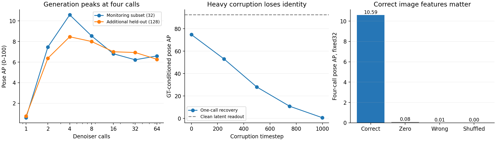
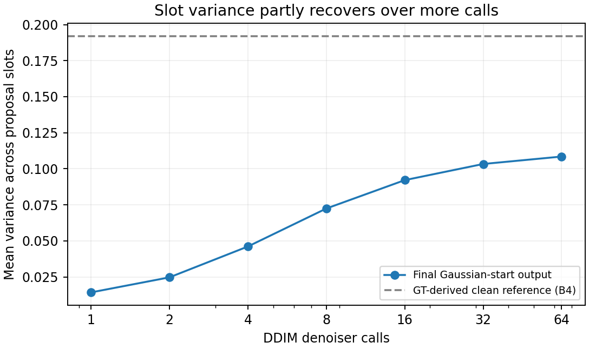

# V26 epoch079: latent reconstruction, sampling and image use

2026-10-25. Single seed42 pilot; final epoch079, 120,000 optimizer updates. No retraining or checkpoint selection. Temporary read-only probes; original checkpoints/source unchanged.

## Completed full-test result

| Calls | Pose AP | Box AP | Images |
|---:|---:|---:|---:|
| 1 | 0.63 | 3.39 | 8,000 |
| 4 | 7.33 | 14.71 | 8,000 |

V24 control epoch079 one-call pose AP is 54.91 on the same 8,000 images. V26 changes architecture, training targets and inference compute; this is not an isolated ablation. All AP values here use the 0–100 convention.

## More calls

Same Gaussian start per image for every call count, seed 42 + imageID; deterministic native DDIM eta0, FP32, TF32 disabled, resize256/427 and corrected native pose NMS. Projected image tokens extracted once per image. The temporary cached-feature sampler was bitwise identical to native K4 predictions on the parity image; fixed32 K1/K4 AP exactly reproduced saved monitoring values.

| Calls | Fixed32 pose AP | Additional128 pose AP | Additional128 box AP |
|---:|---:|---:|---:|
| 1 | 0.60 | 0.75 | 3.19 |
| 2 | 7.47 | 6.38 | 11.52 |
| 4 | 10.59 | 8.46 | 15.22 |
| 8 | 8.55 | 8.01 | 15.24 |
| 16 | 6.81 | 7.00 | 14.79 |
| 32 | 6.23 | 6.93 | 14.96 |
| 64 | 6.60 | 6.27 | 15.26 |

The additional128 were selected with seed26079, excluding the monitoring32, before examining their outcomes. Both subsets peak at K4; there is no evidence here that a large call budget repairs the model. These are subset diagnostics, not full-test K2/K8/K16/K32/K64 evaluations.

On the additional128, raw proposals with existence >=0.5 and GT OKS>=0.5 cover 248/447 people (55.48%) at K4, versus199/447 (44.52%) at K64. K4 accepts4,493 raw proposals and counts3,454 duplicates; K64 accepts4,668 and counts3,328 duplicates. These raw counts precede NMS and are distinct from AP recall. Duplication counts each qualified proposal assigned to its best-OKS GT beyond the first per GT; this is an analysis statistic, not model matching.

## Decoding GT-derived latents

Build the training-style50 proposals from held-out GT, in fixed batches of4: all originals, replacement duplicates and foreign-image negative poses. Use the known slot correspondence; do not give it to either transformer. Clean h0 is encoded with the correct image. Corrupt that exact h0 once at the stated timestep and decode with one denoiser call. Hold h0 and epsilon fixed for image interventions. These measurements are GT-conditioned reconstruction, not detection from noise.

| Input | Pose AP | Box AP | Mean own-person OKS, originals | Latent MSE |
|---|---:|---:|---:|---:|
| Clean h0 readout | 92.45 | 45.24 | 0.975 | — |
| Recover t=0 | 74.84 | 43.01 | 0.912 | 0.0162 |
| Recover t=249 | 53.09 | 38.91 | 0.799 | 0.0238 |
| Recover t=499 | 28.08 | 29.00 | 0.632 | 0.0560 |
| Recover t=749 | 10.92 | 18.60 | 0.406 | 0.1568 |
| Recover t=999 | 0.66 | 4.76 | 0.177 | 0.2729 |

Clean reconstruction is strong: all133 original people have their own decoded pose at OKS>=0.5, mean own-person OKS0.975. Labeled-joint mean absolute error is0.00372 of the relevant image dimension per coordinate. Original-only proposals with oracle existence give92.07 pose AP, similar to ordinary clean92.45; clean AP is not chiefly constrained by duplicate ranking. Box decoding is substantially weaker than joint decoding even from clean latents.

The denoiser itself loses precision: even t0 (noise variance fraction0.0000413) falls to74.84 AP from92.45. Larger corruption exposes a much greater problem: t499 is28.08, t749 is10.92, t999 is0.66. These are single-call recoveries, separate from the multi-call Gaussian sweep. Noise variance fractions at t249/499/749/999 are15.30%/50.62%/85.57%/~100%.

At t999, average positive/negative existence probabilities are0.409/0.410: they are indistinguishable despite known source labels. Across-slot latent variance falls from0.192 in clean h0 to0.0148 in the recovered h0 (~92% reduction). This directly shows loss of slot diversity at the first high-noise prediction. It is not a claim that the entire clean representation has collapsed.

## Image dependence and attention

| K4 image features | Fixed32 pose AP |
|---|---:|
| Correct | 10.5911 |
| Zero | 0.0783 |
| Wrong | 0.0093 |
| Shuffled | 0.0016 |

For zero features, retain image positions and padding; for wrong features, resize another held-out image into the receiver tensor shape and retain receiver positions/mask. Shuffle permutes image content tokens while positions/mask remain fixed; it mixes feature levels as well as spatial positions, so this is a content/position alignment intervention, not a pure spatial-only ablation. These out-of-distribution interventions establish strong dependence, not a unique causal explanation of the baseline failure.

Clean encoding also depends strongly on image content: clean pose AP falls from92.45 to0.67 with zero features and9.89 with wrong features. When correct h0 is held fixed, the near-clean denoiser can preserve much information without image features (t0 zero-feature AP69.14), but high-noise recovery cannot. The wrong-feature B4 control rolls feature tensors across images of differing padding; treat it as secondary to the B1 generation controls.

A read-only QK attention probe averages the8 heads and measures attention mass inside each known positive slot’s own GT box. The uniform valid-token baseline averages23.85%. Clean layer2 assigns68.20% there; the final denoiser layer at t499 assigns about77%, and at t999 about46%. Padding tokens are excluded; feature-cell centers are mapped from padded inputs to unpadded target coordinates. These are positive-slot-weighted averages, including duplicates, on32 images; large/overlapping boxes and head averaging limit interpretation. Negative slots have no GT box, so their stored zero box masses are placeholders, not localization measurements.

Thus image attention is active and spatially relevant in the GT-conditioned path. This does not establish precise, distinct-person attention during Gaussian generation; poor detection and duplicated proposals show that image use is insufficient.

## Interpretation and next diagnostic

The clean representation/readout can preserve GT poses. The weak point is high-noise person generation plus imperfect denoiser reconstruction, with severe repetition and incomplete person coverage. The observed high-noise variance shrinkage and indistinguishable existence scores are consistent with conditional averaging under the fixed-correspondence latent MSE when slot identity has been erased. This mechanism is a hypothesis supported by the probes, not a controlled proof that one loss term or architecture choice caused the failure. Diffusion can in principle recover multimodality over multiple calls; this trained sampler does not improve beyond four in these tests.

Before another model change, a useful bounded follow-up is a frozen-forward gradient/loss analysis and a controlled denoiser-only fit on fixed clean targets, separating target drift from the high-noise correspondence objective. No new training was launched by this investigation.

## Artifacts and reproducibility

- Checkpoint: `/storage/outputs/pose-graph-diff/results/poseflow_v26_latent_diffusion/20261024_194251/seed42/checkpoints/epoch079.ckpt`.
- Frozen source: `/storage/outputs/pose-graph-diff/results/poseflow_v26_latent_diffusion/20261024_194251/workspace`.
- Temporary scripts, console logs, exact image manifests, per-condition predictions, metrics, variance, attention and SHA256 provenance: `tmp/v26_diagnostics/` and its `results/` subdirectory.
- Existing full-test metrics: run `seed42/full_test/metrics.json`; source/checkpoint coverage was already recorded by the frozen worker.
- Sampling parity passed; fixed32 results reproduced. No production model edits or new TensorBoard server.

## Follow-up: variance through actual multi-call sampling

The original 0.192 → 0.0148 comparison concerned a **single** prediction from
GT-derived latents corrupted at t999, not final multi-call generation. A new
read-only probe measured every actual DDIM call on the same32 images, from
Gaussian starts, seed42+imageID. Native K4 parity was bitwise exact.

| Total calls | Final predicted-clean slot variance |
|---:|---:|
| 1 | 0.01431 |
| 2 | 0.02474 |
| 4 | 0.04614 |
| 8 | 0.07247 |
| 16 | 0.09215 |
| 32 | 0.10335 |
| 64 | 0.10850 |

The GT-derived clean reference is0.19196, measured on the same images with
training-style B4 proposal construction. Generated slots have no known
correspondence to these GT slots; this is a distributional reference.

In K4, successive predicted-clean variances are0.01431 →0.04539 →0.04845
→0.04614 at times999/749/499/249. Thus the first-call suppression partly
recovers; it does not stay at~92% below reference. Final K4 is~76% below
the reference, final K64~43% below. These percentages describe variance,
not the root-mean-square spread or counts of people.

Crucially, the intermediate noisy DDIM state has variances0.853,0.532 and
0.198 after the first three K4 updates. The sampler retains variation in
its estimated-noise component; it does not replace the whole state with
the first predicted-clean vector. At the final update the state equals
the clean prediction.

**Interpretation update:** reduced output diversity persists, but its recovery
with more calls while pose AP worsens shows that this scalar cannot explain
or measure detection success by itself. It does not establish persistent
representation collapse, and the one-call92% figure should not be presented
as the final multi-call result. High-noise conditional averaging remains a
possible contributor, not a demonstrated complete cause of poor sampling.

Raw per-image/per-call values: `tmp/v26_diagnostics/results/trajectory_variance.json`.
