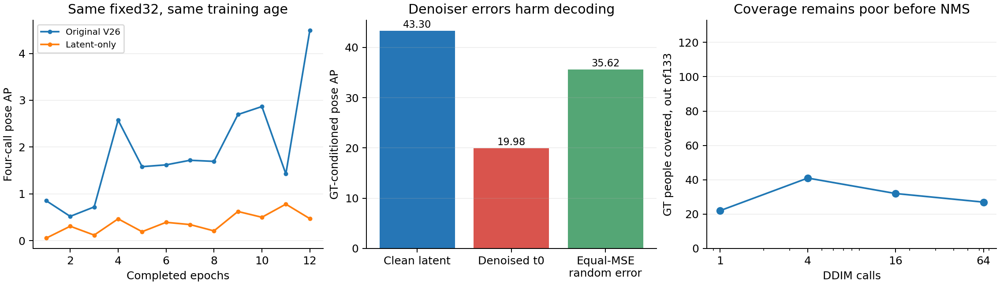

# V26 latent-only failure audit: epoch011

2026-10-25. Read-only investigation requested after poor Gaussian-start AP. Pinned the completed epoch011 checkpoint (12 completed epochs;18,000 optimizer updates). Training continues untouched. All new model interventions use that exact checkpoint; no retraining, weight edits or new TensorBoard.

## Findings

The first high-noise prediction nearly averages slots, but this does not describe the complete multi-call failure. Long sampling restores latent spread without recovering accurate distinct people. Separately, even almost-clean latents suffer a large decoding loss after the denoiser. Latent MSE is not adequately tracking downstream fidelity in this experiment.

## Same-age learning curves

| After12 completed epochs | Original V26 | Latent-only |
|---|---:|---:|
| Fixed32 Gaussian K4 pose AP | 4.493 | 0.470 |
| Validation latent MSE | 0.16210 | 0.06560 |
| Validation clean task | 5.2124 | 5.0626 |
| Validation denoised task | 12.9163 | 15.1246 |

Both runs use the same monitoring32 images and seed42+imageID; same training/data recipe and initialization. Validation losses overlap trainval and are fit diagnostics. Their jointly learned target spaces differ, so the lower MSE is not error to a shared reference. The new K4 AP fluctuates near zero rather than declining monotonically every epoch; the substantial persistent gap is real. From6 to12 completed epochs, latent-only validation MSE improves0.08276→0.06560 and clean task7.2226→5.0626, while denoised task only changes15.5215→15.1246.

Original and earlier latent-only checkpoints are not retained at matched ages. Saved monitoring/validation metrics support the same-age comparison, but there is no same-age frozen-weight counterfactual. Original epoch079 diagnostics are not presented as matched-age evidence.

## Reconstruction versus recovery

Training-style B4 targets on the held-out32: every GT person, replacement duplicates, and foreign-image negatives. Clean latent tensors are held fixed within corruption and correction experiments. AP uses the native decoder and corrected pose NMS.

| Input to readout | Pose AP | Latent MSE to clean |
|---|---:|---:|
| GT_clean | 43.300 | 0.00000 |
| conditional/t0 | 19.983 | 0.01234 |
| conditional/t249 | 22.785 | 0.01032 |
| conditional/t499 | 9.406 | 0.02712 |
| conditional/t749 | 1.472 | 0.09802 |
| conditional/t999 | 0.083 | 0.22992 |

Clean latents retain useful person distinctions: mean own-person OKS0.852 (image-averaged). This is not complete clean-encoder collapse, and clean reconstruction is still imperfect at this early epoch.

At t0, corruption noise variance fraction is only0.0000413. The denoiser reduces clean readout43.30AP to19.98AP despite latent MSE0.01234. Adding deterministic isotropic random error to clean h0, matched exactly to that same per-image MSE, gives35.62AP. At t499, denoiser9.41AP versus equal-MSE random error24.04AP. These fixed-seed controls show the error structure is substantially more harmful to decoding than its scalar magnitude suggests; they are not evidence about all perturbation distributions.

Oracle decompositions separate each image latent mean from deviations between slots. At t499, replacing the predicted mean with the true clean mean improves9.41→12.07AP; replacing the predicted slot deviations with true clean deviations improves9.41→30.77AP. Both are GT oracles, not deployable fixes. Both mean error and person-specific residual errors matter.

## High-noise averaging and multistep behavior

For conditional t999, clean across-slot variance is0.19594 and recovered variance0.00222 (~99% smaller). Centered MSE is0.19847, essentially no better than the oracle image-mean predictor variance floor0.19594. Positive/negative source slots receive mean existence0.632/0.636, providing no useful discrimination. At almost pure noise, assigned source identity is itself unavailable; an averaged clean estimate is not by itself proof that a diffusion model is broken.

| Gaussian calls | Pose AP | Final latent slot variance | Raw GT coverage OKS>=0.5 | Raw coverage OKS>=0.75 |
|---:|---:|---:|---:|---:|
| 1 | 0.043 | 0.00224 | 22/133 | 1/133 |
| 4 | 0.470 | 0.04839 | 41/133 | 8/133 |
| 16 | 0.635 | 0.16170 | 32/133 | 1/133 |
| 64 | 0.620 | 0.20313 | 27/133 | 2/133 |

Coverage counts all50 raw proposals regardless of score, before NMS; a GT person is covered if any predicted pose reaches the stated OKS. At64 calls variance0.20313 reaches the clean0.19594 reference, yet coverage decreases from41 people atK4 to27 and pose AP stays0.62. The recovered variation is not reliable person recovery. Clean reference uses B4 constructed targets; generated slots have no GT correspondence.

Changing Gaussian seed at K4 changes recovered latents substantially: mean paired latent MSE0.12182 and joint-coordinate MSE0.01786. Thus the checkpoint does not wholly ignore noisy input or output a fixed image-only vector after multiple calls. Identical zero starts produce identical slots by permutation-equivariant architecture; that control is not independent evidence of learned collapse.

## Scoring, NMS, normalization and spread controls

| K4 intervention | Pose AP |
|---|---:|
| Native | 0.470 |
| No pose NMS | 0.399 |
| GT oracle best-OKS quality ranking | 3.421 |
| LayerNorm before readout | 0.476 |
| Double deviations between slots | 0.625 |
| Quadruple deviations between slots | 0.076 |

Native AP exactly reproduced the saved epoch011 monitor; cached-feature K4 matched native sampling bitwise on the parity image. Removing NMS worsens AP, so it does not explain the failure. GT-based quality ranking helps, establishing a scoring problem, but geometry remains weak (only8/133 GT people covered at OKS0.75 atK4). Oracle ranking is diagnostic, not an exact best-achievable AP bound.

K4 predicted latent RMS0.987 is already close to clean1, with mean channel offset~0.00077. LayerNorm barely changes AP. Merely increasing slot spread also fails to restore useful detection. Conditional t0 normalization changes19.98→20.45AP, still far below clean43.30. A simple norm/scale correction does not rescue this checkpoint.

## What the loss ablation establishes

The frozen config has denoised_task_loss_weight0 and latent_loss_weight1. The implemented objective is exactly0.5*clean_task + latent_MSE. Corruption source and target remain detached; gradient-contract tests established that decoded-task supervision is absent. No loss wiring or sampler/evaluator discrepancy was found in these checks.

Removing the decoded task loss changed three gradient routes: task gradients into the denoiser, task adaptation of the shared readout to recovered latents, and task gradients through denoising image features. This experiment alone cannot attribute the regression to just one route. The observed poor near-clean decoding and equal-MSE controls support the concern that plain latent matching fails to preserve task-relevant information.

A sensible next bounded investigation would isolate these routes on the same weights, or test stronger semantic supervision for the jointly trained representation. No frozen-autoencoder run or unapproved architecture change is implied. Any later layer/FiLM/AdaLN or REPA/DINO experiment should measure near-clean recovery and raw person coverage as well as latent MSE.

## Artifacts

- Pinned checkpoint: `/home/gasparyanartur/dev/pose-graph-diff/tmp/v26_collapse/epoch011.ckpt`.
- Checkpoint SHA256: `528e8500a0963606243d4409a6793cf819d9e82f3ff5a40bd58c4319d1da8ff0`.
- Raw results/predictions: `tmp/v26_collapse/results/metrics.json`, `normalization.json`, and per-condition prediction JSONs.
- Same-age curves: `tmp/v26_collapse/learning_curves.json`.
- Temporary probe source/logs and pin metadata: `tmp/v26_collapse/`.
- FP32, TF32 disabled, native resize256/427, fixed deterministic proposal/noise seeds. No model changes or new training were performed.
