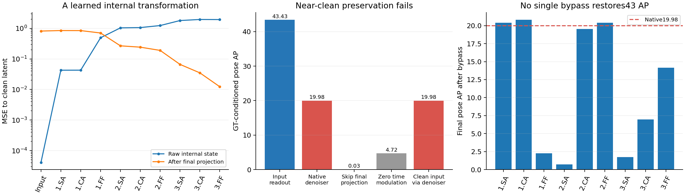

# V26 latent-only: near-clean denoiser sublayer trace

2026-10-25. Pinned epoch011 (12 completed epochs), same fixed32 held-out images and training-style B4 proposals as the failure audit. No weights, architecture or live training changed.

## Result

The denoiser is not operating as a near-identity residual refinement at t0. Its blocks substantially transform the input representation, and the final projection maps back toward the clean latent space. The complete learned transformation retains task-relevant information imperfectly. The trace does not identify a single faulty or removable layer.

## Controls and exact parity

- Manual tracing reproduces native predicted clean latents bitwise on every one of8 B4 batches.
- Clean latent readout43.300AP; noisy t0 input readout43.431AP; native denoiser output19.983AP.
- Exact clean latent through the t0 denoiser19.980AP: the drop is essentially the same without corruption.
- FP32, TF32off, native256/427 preprocessing and corrected pose NMS. Proposal seed42000+batchoffset; noise seed50000+batchoffset.

## Stage trace

SA=self-attention, CA=image cross-attention, FF=feedforward. Raw-state decoding applies the shared readout directly. Projected decoding applies the trained final linear projection before the readout at every stage. Neither intermediate mode was trained for task prediction; these are descriptive probes, not valid inference exits.

| Stage | Raw state MSE to h0 | Raw pose AP | Projected state MSE | Projected pose AP | Raw update RMS |
|---|---:|---:|---:|---:|---:|
| input | 0.00004 | 43.431 | 0.81355 | 0.000 | — |
| L1/self_attention | 0.04275 | 18.388 | 0.84616 | 0.000 | 0.20643 |
| L1/image_attention | 0.04287 | 18.179 | 0.84245 | 0.000 | 0.03447 |
| L1/ffn | 0.49112 | 3.997 | 0.70372 | 0.000 | 0.67008 |
| L2/self_attention | 1.03564 | 0.028 | 0.26774 | 0.433 | 0.85531 |
| L2/image_attention | 1.05737 | 0.019 | 0.24218 | 0.794 | 0.06578 |
| L2/ffn | 1.23177 | 0.029 | 0.18971 | 0.751 | 0.45996 |
| L3/self_attention | 1.79676 | 0.005 | 0.06618 | 2.096 | 0.49594 |
| L3/image_attention | 1.94662 | 0.002 | 0.03500 | 14.150 | 0.21656 |
| L3/ffn | 1.93154 | 0.035 | 0.01234 | 19.983 | 0.39820 |

Raw input MSE is~0.000041, rises to~1.93 in the final hidden state, then falls to0.01234 after the projection. Raw intermediate AP is therefore not a basis for blaming whichever layer first makes it fall. Much of the movement is a learned change of internal representation, which the projection partially reverses.

The projection alone on noisy input gives0AP; the full body without projection gives0.035AP. The learned body and projection depend on one another. This is consistent with the absence of a direct global input-to-clean-output identity skip, but does not prove that adding such a skip will improve a retrained model.

## Recomputed bypass tests

Each bypass starts from the original noisy input and reruns every downstream operation and the final projection. This is stronger evidence than a raw intermediate readout, but remains an out-of-distribution frozen-model intervention.

| Bypassed component | Final pose AP |
|---|---:|
| L1/self_attention | 20.410 |
| L1/image_attention | 20.809 |
| L1/ffn | 2.248 |
| L2/self_attention | 0.700 |
| L2/image_attention | 19.525 |
| L2/ffn | 20.392 |
| L3/self_attention | 1.730 |
| L3/image_attention | 6.949 |
| L3/ffn | 14.150 |
| L1 | 1.937 |
| L2 | 0.050 |
| L3 | 0.751 |
| all_blocks | 0.000 |
| final_projection | 0.035 |

Native final AP19.983. The best single bypass is first-layer image attention20.809, a small fixed32 difference, nowhere near direct-input43.431. Second-layer self-attention is especially important: bypassing it reduces AP to0.700. Last-layer image attention and FFN also materially contribute. There is no large single-layer rescue.

## Self attention and timestep conditioning

| Self-attention block | Mass on self slot | Mass on same-person slots | Same-person uniform baseline |
|---|---:|---:|---:|
| L1/self_attention | 3.18% | 26.98% | 19.97% |
| L2/self_attention | 15.35% | 70.62% | 19.97% |
| L3/self_attention | 6.07% | 36.39% | 19.97% |

All attention statistics average heads; same-person statistics are over known positive slots, including constructed duplicates. The uniform self-slot baseline is2%. In block2 the model strongly attends to its own person group, so simply failing to associate proposals with themselves is not supported. These probabilities do not establish copying, since the values and attention output undergo learned transforms and are added residually.

Zeroing every learned timestep scale/shift reduces final AP to4.715. Supplying timestep999 for the same near-clean inputs yields0.458AP. Thus the time path is connected and materially useful at low noise. These controls do not establish that its learned dependence is optimal across all times.

Timestep0 modulation RMS values:

| Sublayer | Scale RMS | Shift RMS |
|---|---:|---:|
| L1/self_attention | 0.5054 | 0.1169 |
| L1/image_attention | 0.1064 | 0.1468 |
| L1/ffn | 0.3040 | 0.0699 |
| L2/self_attention | 0.2884 | 0.1551 |
| L2/image_attention | 0.0932 | 0.1923 |
| L2/ffn | 0.1519 | 0.1152 |
| L3/self_attention | 0.2729 | 0.1273 |
| L3/image_attention | 0.1728 | 0.1647 |
| L3/ffn | 0.1136 | 0.1179 |

## Interpretation and limits

The near-clean failure is a property of the complete learned denoising function. The model transforms already useful latents substantially, then approximately reconstructs them; the residual error harms the shared readout. Time conditioning and self-attention both contribute. The evidence does not localize the failure to an implementation bug in a specific sublayer, nor does it prove the output projection should be removed.

An explicit low-noise identity path or preconditioned residual parameterization is a targeted candidate for a later controlled experiment. Existing FiLM/AdaLN-style normalization is already active. This diagnostic does not authorize an architecture edit, change the running experiment, or imply freezing the jointly trained clean encoder.

## Artifacts

- Checkpoint `/home/gasparyanartur/dev/pose-graph-diff/tmp/v26_collapse/epoch011.ckpt`, SHA256 `528e8500a0963606243d4409a6793cf819d9e82f3ff5a40bd58c4319d1da8ff0`.
- Raw traces, attention summaries, per-condition AP and serialized predictions: `tmp/v26_layer_trace/results/`.
- Source/log/provenance: `tmp/v26_layer_trace/`.
- Final projection matrix statistics: `tmp/v26_layer_trace/projection.json`; singular values alone are not evidence of a bottleneck or a cause of AP failure.
