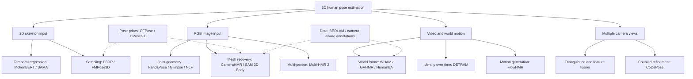

# How current 3D human pose estimation methods work

Literature audit and tree. Research cutoff: **5 November 2026**.

This audit covers human body joints, whole-body pose and mesh recovery from RGB images and video. It distinguishes monocular, multi-person, world-space and multi-view estimation. Specialized hands-only, face-only, animal, RGB-D, inertial, radio and object-pose methods are adjacent fields; they are not exhaustively audited here.

“Current SOTA” means the leading methods and methodological fronts identified in the primary sources below, under their stated tasks and protocols. There is no defensible single winner across all of these tasks. This is a broad mechanism and evidence audit, not a certified exhaustive systematic review or a local reproduction of published results.

## 1. Main findings

1. **The field has several different prediction problems.** Lifting an already detected skeleton, reconstructing a body from pixels, detecting every person, and recovering world trajectories require different evidence and evaluation. A low root-relative joint error does not establish accurate scene placement.
2. **Recent progress combines visual evidence, anatomical structure and data scale.** The image-conditioned joint branch includes PandaPose and Glimpse; mesh recovery includes NLF, CameraHMR, PromptHMR and SAM 3D Body. These methods do not all share a generative sampler. [PandaPose](https://papers.neurips.cc/paper_files/paper/2025/hash/820134d062a5f807f0b7d86ec5088e4e-Abstract-Conference.html), [Glimpse](https://proceedings.mlr.press/v306/tang26p.html), [NLF](https://arxiv.org/abs/2407.07532), [SAM 3D Body](https://arxiv.org/abs/2602.15989).
3. **Probabilistic methods address ambiguity, but selection is part of the method.** Diffusion and flow matching produce alternative solutions. Their practical output depends on averaging, reprojection, a learned selector, or further fitting. Best-of-many results using the true 3D pose measure sample coverage. [D3DP](https://arxiv.org/html/2303.11579), [FMPose3D](https://arxiv.org/html/2602.05755v1).
4. **Some widely repeated headline numbers are not deployable prediction errors.** D3DP reports 35.4 mm for joint-wise oracle selection and 39.5 mm for practical joint-wise reprojection aggregation. GAtFuN explicitly reports 38.3 mm under practical J-Agg, separately from its lower headline comparison. [D3DP, Table 1](https://arxiv.org/html/2303.11579), [GAtFuN, Table 8](https://openaccess.thecvf.com/content/WACV2026/papers/Pham_Motion-Aware_Graph_Fusion_Network_for_3D_Human_Pose_Estimation_WACV_2026_paper.pdf).
5. **The 2026 frontier extends beyond pose regression.** Examples include coupled 2D/3D refinement, camera prediction, persistent tracking queries and physics-based post-training. These are distinct mechanisms and should be studied separately. [CoDePose](https://media.eventhosts.cc/Conferences/ECCV2026/pdfs/11345.pdf), [Multi-HMR 2](https://arxiv.org/abs/2606.14841), [DETRAM](https://arxiv.org/abs/2607.09089), [FlowHMR](https://arxiv.org/abs/2610.03691).

## 2. Literature tree

The tree is a **taxonomy**, not a claim that every child directly builds on its parent. The lineage map in Section 3 distinguishes explicit development from methodological connections. Dates below are publication years where verified; an arXiv posting may have a different year.

```text
3D HUMAN POSE ESTIMATION
|
+-- A. A skeleton is the input: 2D -> 3D lifting
|   |
|   +-- Deterministic geometric regression
|   |   +-- SimpleBaseline (2017): residual MLP
|   |   +-- SemGCN (2019): skeleton graph relationships
|   |   +-- VideoPose3D (2019): dilated temporal convolutions
|   |
|   +-- Temporal representation learning
|   |   +-- PoseFormer (2021): spatial then temporal transformers
|   |   +-- MixSTE (2022): alternating joint/frame attention, sequence output
|   |   +-- MHFormer (2022): communicating hypothesis representations
|   |   +-- PoseFormerV2 (2023): time/frequency compression
|   |   +-- MotionBERT (2023): pretrained motion representations
|   |   +-- MotionAGFormer (2024): attention + graph streams
|   |   +-- KTPFormer (2024): kinematic/trajectory-aware attention
|   |   +-- PoseMamba (2025): bidirectional state-space scans
|   |   +-- SAMA (2025): topology-aware states, joint-specific timescales
|   |   +-- GAtFuN (2026): graph/transformer velocity fusion
|   |   +-- SemGAN (2026): semantic and kinematic adversarial constraints
|   |
|   +-- Probabilistic lifting
|   |   +-- DiffPose [Gong et al., CVPR 2023]: uncertainty-shaped diffusion
|   |   +-- DiffPose [Holmquist & Wandt, ICCV 2023]: heatmap-sample conditioning
|   |   +-- D3DP (2023): clean-pose denoising + hypothesis aggregation
|   |   +-- FinePOSE (2024): part/text prompts in a diffusion denoiser
|   |   +-- DDHPose (AAAI 2024): bone-length/direction diffusion
|   |   +-- GAtFuN diffusion variant (2026)
|   |   +-- DiMMPose (2026): prompt-conditioned diffusion + Mamba
|   |   +-- FMPose3D (2026): conditional flow matching + reprojection weighting
|   |
|   +-- Improve the skeletal representation
|       +-- HiPART (2025): autoregressive dense 2D skeleton generation
|
+-- B. Image evidence remains available: image-conditioned 3D joints
|   +-- Integral Pose (2018): expectation of a spatial heatmap
|   +-- MeTRAbs (2021 journal): metric heatmaps + absolute location
|   +-- PandaPose (NeurIPS 2025; arXiv 2026): 3D anchors + lifted visual features
|   +-- Glimpse (2026): joint/limb image sampling + geometric feature correction
|   +-- NLF (2024): query continuous anatomical points, optionally fit a mesh
|
+-- C. Recover an articulated body surface: human mesh recovery
|   |
|   +-- Body representations and fitting
|   |   +-- SMPL (2015): pose/shape -> skinned body mesh
|   |   +-- SMPL-X + SMPLify-X (2019): body, hands, face + fitting/prior
|   |   +-- MHR: separate skeletal structure and surface shape
|   |   +-- Anny: interpretable body model across ages
|   |
|   +-- Amortized image -> body parameters
|   |   +-- HMR (2018): regression + reprojection + adversarial body prior
|   |   +-- SPIN (2019): model fitting supplies training targets
|   |   +-- PARE (2021): body-part attention for occlusion
|   |   +-- CLIFF (2022): preserve full-image crop/camera information
|   |   +-- HMR 2.0 / 4DHumans (2023): transformer mesh recovery + tracking
|   |   +-- SMPLer-X (2023): scale expressive whole-body training
|   |   +-- CameraHMR (2025): perspective cameras + improved pseudo labels
|   |   +-- PromptHMR (2025): full-image spatial/semantic prompting
|   |   +-- SAM 3D Body (2026 paper): promptable body/hand decoders, MHR
|   |   +-- Fast SAM 3D Body (2026 preprint): restructure the inference pipeline
|   |
|   +-- Geometry first, then body parameters
|   |   +-- HybrIK (2021) -> HybrIK-X: joints + analytic swing / learned twist
|   |   +-- NLF (2024): continuous point localization -> optional body fitting
|   |
|   +-- Probabilistic parameter recovery / fitting
|       +-- ProHMR (2021): image-conditioned normalizing flow
|       +-- ScoreHMR (2024): conditional diffusion + observation guidance
|
+-- D. Detect and reconstruct several people in one image
|   +-- ROMP (2021): center heatmap + mesh-parameter map
|   +-- BEV (2022): image-plane and depth-space center reasoning
|   +-- Multi-HMR (2024): center detection + person cross-attention
|   +-- SAT-HMR (2025): scale-adaptive image tokens + set prediction
|   +-- Multi-HMR 2 / MuCHeR (2026): DETR + camera + tracking features
|   +-- DETRAM (2026): detection, tracking and prompt queries across frames
|
+-- E. Recover motion and position in the world
|   +-- VIBE (2020): temporal mesh regression + motion discriminator
|   +-- WHAM (2024): motion/image fusion + camera motion + contact refinement
|   +-- TRAM (2024): camera trajectory and body motion composed in world space
|   +-- GVHMR (2024): gravity-view representation + global trajectory recovery
|   +-- HumanMM (2025): motion recovery across video shots
|   +-- Mocap-2-to-3 (2026): 2D diffusion pretraining -> multi-view motion learning
|   +-- HumanBA (2026): decouple human/camera motion for bundle adjustment
|   +-- FlowHMR (October 2026 preprint): flow matching + physics/reprojection rewards
|
+-- F. Several camera views provide geometric evidence
|   +-- Learnable Triangulation (2019): confidence-weighted / volumetric fusion
|   +-- VoxelPose (2020): 3D person proposals + local pose volumes
|   +-- MvP (2021): person/joint queries attend to multiple views
|   +-- Faster VoxelPose (2022): project volumes onto coordinate planes
|   +-- CoDePose (2026): coupled multi-view 2D/3D denoising
|
+-- G. Priors and reduced-supervision learning (cross-cutting)
|   +-- SMPLify-X / VPoser (2019): learned low-dimensional pose prior
|   +-- ElePose (2022): plausible random projections + learned camera elevation
|   +-- GFPose (2023): time-dependent joint score fields
|   +-- DPoser (2024): diffusion prior for inverse problems
|   +-- DPoser-X (2025): masked whole-body/part training
|
+-- H. Data and evaluation (cross-cutting)
    +-- Human3.6M, MPI-INF-3DHP: controlled joint estimation
    +-- 3DPW, EMDB, RICH: in-the-wild body and/or motion evaluation
    +-- AGORA: multi-person detection + body/whole-body reconstruction
    +-- BEDLAM -> BEDLAM2.0: synthetic bodies and camera motion
    +-- H3WB: whole-body joint estimation
    +-- AthletePose3D, RSP3D: stress tests beyond routine healthy-adult motions
```

For a compact visual overview:



## 3. Methodological lineage

Arrows below mean either an explicit extension or a **conceptual development**, as stated. Similarity alone does not establish a direct citation dependency.

| Line | What actually evolves | Relationship |
|---|---|---|
| SimpleBaseline → VideoPose3D → PoseFormer / MixSTE | A single pose mapping becomes a temporally conditioned mapping | Conceptual progression; different architectures |
| PoseFormer → PoseFormerV2 | Preserve useful long-sequence information using frequency compression | Explicit architectural development |
| Transformer lifting → MotionAGFormer / KTPFormer / SAMA | Add skeletal structure or change the sequence operator | Related solutions, not one serial family |
| D3DP → FinePOSE → GAtFuN diffusion | A coordinate denoiser gains prompt and motion-graph conditioning | Released implementations acknowledge the earlier systems |
| Diffusion lifting ↔ FMPose3D | Sample conditional 3D alternatives using different learned vector fields | Methodological alternative; not just a different DDIM schedule |
| SMPL → HMR → SPIN → HMR 2.0 → CameraHMR | Differentiable body representation, amortized fitting, stronger image models and labels | Historical line; CameraHMR explicitly upgrades HMR 2.0 |
| SMPL-X → SMPLer-X / PromptHMR | Whole-body representation with larger training mixtures or prompts | Shared representation; distinct methods |
| ROMP / BEV → Multi-HMR → Multi-HMR 2 | Predict several people together; improve context, camera and detection | First arrows conceptual; Multi-HMR 2 is an explicit successor |
| Image mesh recovery → WHAM / TRAM / GVHMR | Add camera/world motion and temporal constraints | Parallel global-motion approaches |
| Learnable Triangulation / VoxelPose / MvP → CoDePose | Cross-view fusion expands into joint correction of 2D and 3D | Conceptual progression, not a shared implementation lineage |
| VPoser → GFPose / DPoser / DPoser-X | Low-dimensional priors expand to noise-dependent pose fields | Conceptual progression; different representations and training |

Primary anchors: [PoseFormerV2](https://openaccess.thecvf.com/content/CVPR2023/papers/Zhao_PoseFormerV2_Exploring_Frequency_Domain_for_Efficient_and_Robust_3D_Human_CVPR_2023_paper.pdf), [CameraHMR](https://arxiv.org/abs/2411.08128), [FinePOSE repository](https://github.com/PKU-ICST-MIPL/FinePOSE_CVPR2024), [GAtFuN repository](https://github.com/phaiyen0493/GAtFuN), [Multi-HMR 2](https://arxiv.org/abs/2606.14841).

## 4. Define the problem before comparing methods

Let an image be \(I\), detected 2D joints be \(u\in\mathbb R^{J\times2}\), and 3D joints be \(X\in\mathbb R^{J\times3}\). A body model maps pose and shape parameters to a mesh, \(V=M(\theta,\beta)\). A camera projects 3D points as

\[
u_j=\pi_K(RX_j+t),\qquad
\pi_K([x,y,z]^\top)=
\begin{bmatrix}f_xx/z+c_x\\f_yy/z+c_y\end{bmatrix}.
\]

This equation explains the main ambiguity: a single projection does not uniquely determine depth, scale, camera parameters or hidden limbs. A learned model resolves some ambiguity using training-distribution priors. It does not make the geometry uniquely observable.

| Problem | Typical prediction | What is still unknown or supplied separately? |
|---|---|---|
| Root-relative lifting | \(X_j-X_{root}\) from 2D joints | Absolute location; often appearance; sometimes scale/camera |
| Image-conditioned joint estimation | 3D joint coordinates from RGB and possibly 2D seeds | Hidden geometry and camera may remain ambiguous |
| Camera-space mesh recovery | Body parameters and camera-relative translation | World orientation/trajectory; shape under clothing |
| World-space motion recovery | Body pose, root trajectory and camera motion across time | Gauge freedoms, metric scale and scene contacts require additional cues/priors |
| Multi-person recovery | A set of bodies, scores and locations | Detection, occlusion, identity and interaction assignment |
| Calibrated multi-view recovery | 3D joints/bodies using camera projection matrices | Cross-view correspondence, missing views and calibration error |

**Root alignment, scale alignment and Procrustes alignment answer different questions.** A method can place a body incorrectly in the room and still receive a good aligned body score. Multi-HMR 2 explicitly audits this gap between pelvis-centered reconstruction and camera-space perception. [Multi-HMR 2](https://arxiv.org/html/2606.14841v1).

### The representations

| Representation | What the model manipulates | Benefit and main limitation |
|---|---|---|
| Cartesian joints | \(J\times3\) coordinates | Direct geometry loss; unconstrained predictions can violate anatomy |
| Image XY plus depth / UVD | Image-aligned coordinates and a depth variable | Convenient image alignment; requires an explicit camera/depth conversion for metric XYZ |
| Bones | Lengths and/or directions on a kinematic tree | Exposes anatomy; local errors accumulate when reconstructing joints |
| Volumetric heatmaps | A probability-like spatial grid per joint | Spatial localization and multimodality; memory and resolution cost |
| Body parameters | Joint rotations, shape, expression and translation | Coherent surface and forward kinematics; harder image alignment and representation-specific errors |
| Continuous localizer field | Query an anatomical point and predict its observed 3D location | Can unify skeleton and mesh labels; not itself an exact parametric body |
| Learned latent | A code decoded into joints or body parameters | Compact prior; a small code error need not mean small geometric error |

References: [Integral Pose](https://arxiv.org/abs/1711.08229), [MeTRAbs](https://arxiv.org/abs/2007.07227), [SMPL](https://smpl.is.tue.mpg.de/), [NLF](https://arxiv.org/abs/2407.07532), [DDHPose](https://arxiv.org/abs/2403.04444).

## 5. How the main method families work

The equations in this section use consistent explanatory notation. They express a family mechanism; they are not presented as verbatim equations or exact objectives of every paper listed.

### 5.1 Deterministic lifting: learn geometry from a skeleton

The baseline is

\[
\widehat X=f_\theta(u),\qquad
\mathcal L_{3D}=\frac1J\sum_j\|\widehat X_j-X_j^*\|_2
\]

or squared coordinate error, depending on the implementation. SimpleBaseline established that a residual MLP is a meaningful control. Graph methods replace a flat mapping with interactions between connected or learned-related joints. A schematic graph layer is

\[
H^{\ell+1}=\sigma(\widetilde A H^\ell W^\ell).
\]

The graph supplies structural bias; it is not a hard joint-limit or bone-length constraint. [SimpleBaseline](https://arxiv.org/abs/1705.03098), [SemGCN](https://arxiv.org/abs/1904.03345).

Temporal lifting uses \(\widehat X_t=f(u_{t-r:t+r})\). VideoPose3D uses dilated convolutions. PoseFormer separates spatial and temporal attention; MixSTE alternates them while predicting a sequence. PoseFormerV2 compresses temporal information using frequency components. [VideoPose3D](https://arxiv.org/abs/1811.11742), [PoseFormer](https://arxiv.org/abs/2103.10455), [MixSTE](https://arxiv.org/abs/2203.00859), [PoseFormerV2](https://openaccess.thecvf.com/content/CVPR2023/papers/Zhao_PoseFormerV2_Exploring_Frequency_Domain_for_Efficient_and_Robust_3D_Human_CVPR_2023_paper.pdf).

**What improves:** neighboring frames reveal motion, support occluded joints and suppress detection noise. **What remains:** a coordinate-only lifter cannot recover appearance cues that the 2D detector discarded. A centered window also uses future observations; offline accuracy is not causal streaming performance.

### 5.2 Representation learning, graph/attention hybrids and state-space models

| Method | Mechanism | What the representation means |
|---|---|---|
| [MHFormer](https://arxiv.org/abs/2111.12707) | Generate several internal hypothesis features, allow communication, aggregate into a final pose | Alternative learned representations; not automatically calibrated posterior samples |
| [MotionBERT](https://arxiv.org/abs/2210.06551) | Pretrain DSTformer to reconstruct motion from corrupted/partial 2D sequences; fine-tune for downstream tasks | A reusable motion representation |
| [MotionAGFormer](https://arxiv.org/abs/2310.16288) | Parallel transformer and GCNFormer streams combine global relationships and local skeletal/motion structure | Deterministic spatiotemporal features |
| [KTPFormer](https://arxiv.org/abs/2404.00658) | Kinematics and trajectory topologies modify attention projections | Structural priors inside feature interactions |
| [PoseMamba](https://arxiv.org/abs/2408.03540) | Bidirectional global/local state-space scans with skeletal reordering | Sequence state used to aggregate spatial/temporal evidence |
| [SAMA](https://arxiv.org/html/2507.19852v1) | Fuse topology at feature/state levels; adapt state timescales to each joint's motion | Structure-aware sequence state |
| [GAtFuN](https://openaccess.thecvf.com/content/WACV2026/papers/Pham_Motion-Aware_Graph_Fusion_Network_for_3D_Human_Pose_Estimation_WACV_2026_paper.pdf) | Transformer pose stream and graph motion stream fuse velocity updates; optional diffusion setting | Coordinated pose and motion features |
| [SemGAN](https://link.springer.com/chapter/10.1007/978-3-032-37029-7_10) | Hierarchical semantic generator and cross-frequency discriminator supplement coordinate supervision | A semantic/kinematic training constraint; abstract-level verification here |

A state-space block can be represented schematically by

\[
h_{k+1}=\overline A_kh_k+\overline B_kx_k,
\qquad y_k=C_kh_k+Dx_k.
\]

Here \(k\) is the scan position, not necessarily physical time. Bidirectional joint/frame scans can use the full clip. The existence of an SSM state does not establish that the deployed method carries identity or a posterior between videos, denoising calls or inference invocations. Reported linear sequence complexity also does not make detector preprocessing or multi-hypothesis sampling free.

### 5.3 Retain image evidence while estimating 3D joints

The common design is

\[
F=\operatorname{Encoder}(I),\quad
e_j=\operatorname{Read}(F,r_j),\quad
\widehat X=\operatorname{Geometry}(u,e_{1:J}).
\]

The reference \(r_j\) may be a detected joint, a learned offset, a limb location or an anchor. Unlike coordinate-only lifting, this branch can revisit visual evidence.

| Method | How it uses evidence | Audit distinction |
|---|---|---|
| [Integral Pose](https://arxiv.org/abs/1711.08229) | Convert a normalized heatmap into a coordinate by expectation | Differentiable localization; expectation can average separate modes |
| [MeTRAbs](https://arxiv.org/abs/2007.07227) | Combine metric-space volumetric predictions and image-space evidence for absolute 3D pose | Metric heatmaps differ from image XY plus scaled depth |
| [HiPART](https://arxiv.org/abs/2503.23331) | Tokenize dense 2D skeletons and generate them hierarchically before lifting | Representation densification; generated joints are inferred structure, not new observations |
| [PandaPose](https://papers.neurips.cc/paper_files/paper/2025/hash/820134d062a5f807f0b7d86ec5088e4e-Abstract-Conference.html) | Canonical joint anchors interact with depth-aware lifted image features | Anchor queries combine geometry and appearance |
| [Glimpse](https://proceedings.mlr.press/v306/tang26p.html) | Deformable samples near joints and along limbs; fuse them through a canonical geometric reference | Joint/limb feature refinement, rather than only a skeleton-to-skeleton map |

Glimpse's evaluated configuration uses detected CPN joints and frozen HRNet features. Its 39.3 mm result therefore includes an image feature route; it is not a coordinate-only lifting result. Its shared canonical reference guides feature fusion and does not make hidden 3D geometry directly observed. [Glimpse, Sections 3–4 and Table 1](https://raw.githubusercontent.com/mlresearch/v306/main/assets/tang26p/tang26p.pdf).

### 5.4 Probabilistic lifting: generate several plausible geometries

A deterministic regressor estimates one answer. A probabilistic estimator models \(p_\theta(X\mid u)\) or \(p_\theta(X\mid I)\). Those are different conditionals: knowing only the skeleton discards clothing, shading, occlusion boundaries and other image information.

For Gaussian corruption,

\[
X_\tau=\alpha_\tau X_0+\sigma_\tau\epsilon,
\qquad\epsilon\sim\mathcal N(0,I),
\]

a denoiser may predict noise, a clean pose, a velocity or a score. These parameterizations require the appropriate conversion. For the noise-prediction convention,

\[
s_\theta(X_\tau,\tau,c)\approx
\nabla_{X_\tau}\log p_\tau(X_\tau\mid c)
=-\widehat\epsilon_\theta/\sigma_\tau.
\]

The last equality describes the usual Gaussian score/noise relationship under a matched model and noise convention. A clean-coordinate prediction cannot be called a score without that conversion. GFPose explicitly learns noise-dependent joint gradient fields. [GFPose](https://arxiv.org/abs/2212.08641).

| Method | Distinguishing mechanism | Practical concern |
|---|---|---|
| [DiffPose, Gong et al.](https://arxiv.org/abs/2211.16940) | Pose-specific uncertain initialization and Gaussian-mixture forward construction; context-conditioned reversal | More specialized than standard Gaussian-from-scratch sampling |
| [DiffPose, Holmquist & Wandt](https://arxiv.org/abs/2211.16487) | Samples from 2D heatmaps preserve uncertainty that argmax would discard; transformer embeds those samples to condition diffusion | Separate paper with the same short name |
| [D3DP](https://arxiv.org/html/2303.11579) | Repeated clean-pose prediction from noisy 3D coordinates, conditioned on 2D; controllable hypotheses/steps | Oracle and practical aggregation differ |
| [FinePOSE](https://arxiv.org/html/2405.05216v1) | Part-aware text/learned prompts, pose–prompt communication and timestep modulation inside denoising | Audit prompt availability and the exact reported aggregation |
| [DDHPose](https://arxiv.org/abs/2403.04444) | Diffuse bone length and direction separately with hierarchical spatial/temporal denoising | Different geometry factorization; accepted at AAAI 2024 |
| [DiMMPose](https://www.mdpi.com/1424-8220/26/17/5559) | Bidirectional Mamba blocks plus coarse/fine/motion prompt conditioning | Headline 28.9 mm needs a fully traceable selection protocol; see Section 7 |

The output samples are useful only if the application can use uncertainty or choose an answer. More samples can improve oracle coverage while leaving the practical output nearly unchanged. Moreover, selecting every joint from a different sample can produce a skeleton that was never jointly sampled as one anatomically coherent pose.

### 5.5 Flow matching: learn transport rather than a denoising target

Using noise \(Z\), a training pose \(X\), and a noise-to-data convention,

\[
x_s=(1-s)Z+sX,\qquad
\mathcal L_{FM}=\mathbb E\|v_\theta(x_s,s,u)-(X-Z)\|_2^2.
\]

At inference, integrate

\[
\frac{dx_s}{ds}=v_\theta(x_s,s,u),\qquad x_0\sim\mathcal N(0,I).
\]

This convention runs from \(s=0\) noise to \(s=1\) pose; it is not the time convention of every diffusion paper. A fixed seed has a deterministic ODE trajectory, while different seeds can give different poses. **Flow matching and normalizing flows are also different training constructions.**

FMPose3D combines local graph and global attention branches. Its RPEA procedure keeps low-reprojection-error candidates and averages them with exponential weights. It produces one prediction without selecting using the true 3D target. Its reported single-frame setting is a different comparison group from long-clip temporal lifting. [FMPose3D, Sections 3–4](https://arxiv.org/html/2602.05755v1), [official implementation](https://github.com/AdaptiveMotorControlLab/FMPose3D).

RPEA is motivated by an approximate observation likelihood. Reweighting samples already conditioned on the observed 2D pose is not, by itself, proof of an exactly calibrated Bayesian posterior. A weighted average also need not lie on the manifold of valid articulated bodies. These are analytical limits of the interpretation, not a claim that the reported results are invalid.

### 5.6 Mesh recovery: predict a body model and render its consequences

A parametric body model gives

\[
V=M(\theta,\beta,\psi),\quad X=\mathcal J(V),
\]

where \(\theta\) represents pose, \(\beta\) shape and, where supported, \(\psi\) expression. The differentiable forward model connects compact parameters to vertices and projected landmarks. SMPL uses learned shape/pose deformations and skinning; SMPL-X adds expressive hands and face. Neither is an image estimator by itself. [SMPL](https://smpl.is.tue.mpg.de/), [SMPL-X / SMPLify-X](https://arxiv.org/abs/1904.05866).

A typical training objective combines available supervision:

\[
\mathcal L=\lambda_{2D}\|\pi_K(X)-u\|
+\lambda_{3D}\|X-X^*\|
+\lambda_V\|V-V^*\|
+\lambda_{param}\mathcal L_{param}
+\lambda_{prior}\mathcal L_{prior}.
\]

Actual losses, masks and weights vary. Sparse reprojection alone leaves depth, twist and shape ambiguous. A mesh can look anatomically plausible while fitting the wrong person or body shape.

| Method | What changed | Training/inference role |
|---|---|---|
| [HMR](https://arxiv.org/abs/1712.06584) | Image-to-parameter regression with reprojection supervision and an adversarial body prior | The network amortizes estimation |
| [SPIN](https://arxiv.org/abs/1909.12828) | Fit the body model during training, initialized by the regressor; use improved fits as supervision | Optimization improves targets; it is not simply extra decoder depth |
| [PARE](https://arxiv.org/abs/2104.08527) | Predict soft body-part attention to handle partial visibility | Reorganizes image evidence |
| [CLIFF](https://arxiv.org/abs/2208.00571) | Add crop location/size relative to the full frame and use full-frame projection | Reduces information lost by person cropping |
| [HMR 2.0 / 4DHumans](https://arxiv.org/abs/2305.20091) | ViT and transformer mesh prediction; a separate tracking system uses reconstructed humans | A strong image estimator plus a temporal identity system |
| [SMPLer-X](https://arxiv.org/abs/2309.17448) | Scale model size and diverse whole-body training data; specialize by fine-tuning | Much of the contribution is data/model scale |
| [CameraHMR](https://arxiv.org/abs/2411.08128) | Predict field of view, fit with perspective cameras and dense surface keypoints, improve pseudo labels | Camera/label quality is central, beyond changing the regressor |
| [PromptHMR](https://arxiv.org/html/2504.06397v1) | Full-image transformer attends to spatial and semantic prompts; supports interaction and video extensions | Prompted input contains extra side information |

**HybrIK takes a different route:** predict 3D joints, analytically solve bone swing rotations, and learn the remaining twists from image cues. HybrIK-X extends the approach to whole-body recovery. Joint positions constrain a limb's direction but do not uniquely specify rotation around that direction. [HybrIK](https://arxiv.org/abs/2011.14672), [HybrIK-X](https://arxiv.org/abs/2304.05690).

**NLF takes another route:** predict the observed 3D location of arbitrary canonical anatomical points using a continuous family of localizers. This supports heterogeneous skeleton, dense surface and mesh annotations. Fit a parametric body only when needed. It provides a useful counterexample to the assumption that strong human reconstruction requires direct SMPL-parameter regression. [NLF](https://arxiv.org/abs/2407.07532).

### 5.7 SAM 3D Body and its acceleration

SAM 3D Body is a **promptable encoder–decoder estimator**, not a pose-diffusion sampler. A shared image encoder feeds body and optional hand decoders. Rig/camera, auxiliary joint and optional prompt tokens interact with image features. Output uses MHR, whose skeletal structure and surface shape are separated. Keypoint/mask prompts can guide ambiguous cases. Its data engine and annotation pipeline are major parts of the method. SMPL benchmark evaluation requires conversion between body representations. The model release preceded the February 2026 paper: the repository dates its checkpoint launch to November 2025. [Official repository and release record](https://github.com/facebookresearch/sam-3d-body).

Training combines uncertainty-modulated joint losses, rig-parameter regression, joint-limit penalties and hand-box losses, with simulated prompt rounds and scheduled supervision. The paper describes about seven million annotated images. Hand integration can use elbow/wrist prompts to refine the body estimate. This is a supervised rig estimator with interactive refinement, rather than noise-to-pose generation. [SAM 3D Body, Sections 4–7](https://arxiv.org/html/2602.15989v1).

Fast SAM 3D Body restructures crop processing, batches body/hand work, prunes decoder work and replaces iterative MHR-to-SMPL fitting with a learned mapping. Its “training-free” acceleration description concerns the pretrained recovery pathway; the conversion network is learned. Speed depends on detector, crop count, conversion, hardware and execution backend. Treat its 2026 preprint as an acceleration study rather than an independently reproduced accuracy ranking. [Fast SAM 3D Body](https://arxiv.org/html/2603.15603v1).

### 5.8 Normalizing flows, diffusion priors and guided fitting

These three roles must remain separate:

| Role | Mathematical object | Examples |
|---|---|---|
| Generic pose prior | \(p(\theta)\) or its noise-dependent score | VPoser, DPoser, DPoser-X; GFPose for joint-space pose fields |
| Image-conditioned distribution | \(p(\theta\mid I)\) | ProHMR, ScoreHMR's learned conditional model |
| Observation-guided inference | Prior/conditional model combined with an observation energy | Body fitting, reprojection guidance, multi-view/temporal refinement |

ProHMR uses an invertible normalizing flow to provide conditional samples and likelihoods. ScoreHMR instead refines an initial estimate through diffusion inversion/guided sampling, using observation-specific terms. DPoser formulates pose tasks as inverse problems and uses a diffusion prior with variational diffusion sampling; DPoser-X mixes whole-body and part-specific training through masks. [ProHMR](https://arxiv.org/abs/2108.11944), [ScoreHMR](https://arxiv.org/abs/2403.09623), [DPoser](https://arxiv.org/abs/2312.05541), [DPoser-X](https://arxiv.org/abs/2508.00599).

For an observation energy \(E\), a schematic posterior relation is

\[
\log p(X\mid o)=\log p(X)+\log p(o\mid X)+C,
\qquad\log p(o\mid X)=-E(X;o)+C'.
\]

Using this identity at a noisy diffusion state requires an appropriate likelihood approximation or a clean-state prediction and chain rule. An arbitrary reprojection gradient added to a score is not automatically an exact posterior score.

Training a student with a frozen prior is a further distinction: **score distillation** changes the student's training gradients, whereas **inference guidance** evaluates the prior or energy during deployment. A generic pose prior encourages plausibility; it cannot identify which person in a crowded image supplied the evidence.

### 5.9 Multi-person prediction: detection and association are part of pose estimation

| Method | Person representation and prediction | Main issue addressed |
|---|---|---|
| [ROMP](https://arxiv.org/abs/2008.12272) | Sample mesh parameters at peaks of a body-center map | One-stage multi-person recovery |
| [BEV](https://arxiv.org/abs/2112.08274) | Combine frontal/image and bird's-eye/depth representations; model age/size diversity | Relative depth and overlapping centers |
| [Multi-HMR](https://arxiv.org/abs/2402.14654) | Detect centers; one person query cross-attends to the full image and predicts SMPL-X | Efficient whole-body reconstruction in one image pass |
| [SAT-HMR](https://arxiv.org/abs/2411.19824) | Allocate image tokens according to person scale in a DETR-style system | Preserve small-person detail without uniform high-resolution cost |
| [Multi-HMR 2](https://arxiv.org/html/2606.14841v1) | DETR queries, 2D-location matching, scene camera prediction, Anny body parameters; distill SAM2 tracking features | Detection, metric placement and tracking learned from still-image training |
| [DETRAM](https://arxiv.org/abs/2607.09089) | Detection queries find newcomers; persistent tracking queries carry existing identities; prompt queries target selected people | End-to-end reconstruction and identity across video |

With a fixed query set \(q_i\), Hungarian assignment typically provides one-to-one training matches. A no-person score handles unused queries. Query count sets capacity. Per-person reconstruction metrics alone can conceal missed detections, duplicates or identity swaps.

Multi-HMR 2 and DETRAM illustrate two different temporal designs: associate per-frame features versus maintain identity queries across frames. Neither should be described merely as “adding memory.” The state, update, supervision and reset behavior determine what information actually persists.

### 5.10 Video and world-space recovery

Camera-space poses do not automatically yield world trajectories. With world-to-camera rotation \(R_t\) and translation \(t_t\),

\[
X_t^{world}=R_t^\top(X_t^{camera}-t_t).
\]

Camera errors therefore propagate into body trajectories. Monocular scale and frame ambiguities remain unless the system obtains useful scene information, camera information or learned size/motion priors.

| Method | Mechanism | What to inspect |
|---|---|---|
| [VIBE](https://arxiv.org/abs/1912.05656) | Temporal mesh regression trained with a discriminator over motion sequences | Plausibility versus image fit; camera-relative output |
| [WHAM](https://arxiv.org/abs/2312.07531) | Fuse lifted motion and image features; use camera angular velocity and contact-aware trajectory refinement | Camera preprocessing, contact assumptions and accumulated trajectory error |
| [TRAM](https://arxiv.org/abs/2403.17346) | Recover camera motion/scale using background evidence, then compose it with transformer body motion | SLAM and scene-scale estimation are part of the system |
| [GVHMR](https://arxiv.org/abs/2409.06662) | Predict gravity-view pose, local root motion and stationary-joint information; recover global motion using camera rotation | Coordinate choice reduces orientation ambiguity; preprocessing remains necessary |
| [HumanMM](https://arxiv.org/abs/2503.07597) | Shot-transition detection, robust alignment and motion integration connect global human motion across shots | Shot changes make continuity a different problem; abstract-level coverage here |
| [Mocap-2-to-3](https://openaccess.thecvf.com/content/CVPR2026/html/Wang_Mocap-2-to-3_Multi-view_Lifting_for_Monocular_Motion_Recovery_with_2D_Pretraining_CVPR_2026_paper.html) | Pretrain single-view diffusion on 2D data, then learn multi-view motion structure using 3D data; separate local/global motion | Multi-view training formulation does not imply multi-camera inference |
| [HumanBA](https://openaccess.thecvf.com/content/CVPR2026/html/Yang_HumanBA_Human-Aware_Bundle_Adjustment_via_Global_Human-Camera_Decoupling_CVPR_2026_paper.html) | Remove estimated human motion from joint trajectories to make pseudo-static constraints for bundle adjustment | Human estimates become camera constraints; their reliability matters |
| [FlowHMR](https://arxiv.org/html/2610.03691v1) | Video-conditioned flow matching, then GRPO with video-fidelity and physics-controller tracking rewards | October 2026 preprint; reward improvements need not imply better joint error under another benchmark |

GVHMR's project reports very fast network processing **excluding** tracking, feature extraction and relative-camera-rotation preprocessing. Such numbers are not full-video ingestion latency. [GVHMR project and runtime qualification](https://zju3dv.github.io/gvhmr/).

### 5.11 Multi-view geometry and learned fusion

With known cameras and corresponding observations, weighted triangulation conceptually solves

\[
\widehat X_j=\arg\min_X\sum_vw_{vj}\|\pi_{K_v}(R_vX+t_v)-u_{vj}\|^2.
\]

Learnable Triangulation predicts useful confidence weights or builds a feature volume before 3D decoding. VoxelPose constructs 3D person proposals and then per-person poses without committing to a possibly incorrect full 2D skeleton assignment in each view. MvP uses person/joint queries to attend to multi-view evidence. Faster VoxelPose replaces expensive full 3D operations with coordinate-plane reasoning. [Learnable Triangulation](https://saic-violet.github.io/learnable-triangulation/), [VoxelPose](https://www.ecva.net/papers/eccv_2020/papers_ECCV/papers/123460188.pdf), [MvP](https://proceedings.neurips.cc/paper/2021/file/6da9003b743b65f4c0ccd295cc484e57-Paper.pdf), [Faster VoxelPose](https://arxiv.org/abs/2207.10955).

CoDePose treats detected 2D joints as imperfect observations and jointly refines 2D/3D variables. Its coupled state, cross-view fusion, confidence prediction and body-coordinate consistency losses target error propagation from fixed 2D detections. The reported main result uses four views and 27 frames. Its cross-dataset experiment includes ten epochs of fine-tuning; this is not zero-shot transfer. [CoDePose, Sections 3–4](https://media.eventhosts.cc/Conferences/ECCV2026/pdfs/11345.pdf).

Triangulation is strongly constrained when cameras, correspondence and view geometry are reliable. Calibration errors, narrow baselines, asynchronous frames and correlated detector failures can still dominate. A result with four synchronized views is not evidence of equivalent monocular accuracy.

### 5.12 Reduced supervision and adjacent sensing

ElePose learns a pose that looks plausible under random projections, with a normalizing-flow model of 2D plausibility and a learned camera elevation distribution. It shows how 2D-only training supplies distributional constraints, while still relying on assumptions about cameras and pose distributions. [ElePose](https://arxiv.org/abs/2112.07088).

RGB-D, LiDAR, inertial, head-mounted and radio systems provide different observations. They belong on separate branches when selecting a method. A 2026 multi-modal example uses RGB, LiDAR, mmWave and WiFi with modality-contribution balancing; EvaPose explicitly handles visibility for egocentric estimation. These are primary-source discovery entries here, not a full sensor benchmark audit. [Balanced multi-modal learning](https://openaccess.thecvf.com/content/CVPR2026/html/Qi_Towards_Balanced_Multi-Modal_Learning_in_3D_Human_Pose_Estimation_CVPR_2026_paper.html), [EvaPose](https://openaccess.thecvf.com/content/CVPR2026/html/Dai_Egocentric_Visibility-Aware_Human_Pose_Estimation_CVPR_2026_paper.html).

## 6. Benchmark and metric audit

### Datasets answer different questions

| Dataset | Useful for | Main comparison limitation |
|---|---|---|
| Human3.6M | Controlled joint estimation and temporal lifting | Limited scene/action distribution; detected and GT 2D settings differ |
| MPI-INF-3DHP | Indoor/outdoor joints and transfer | GT/detected input, training versus transfer and annotation scale differ |
| 3DPW | In-the-wild pose/shape and video | Training inclusion, body/joint regressors, alignment and detection handling vary |
| EMDB | Camera-relative bodies and global human/camera motion | Root-relative and world-space evaluations must stay separate |
| RICH | Bodies in environments and interactions | In-domain training versus held-out generalization |
| AGORA | Multi-person bodies/whole body under crowding and varied appearance | Detection-aware metrics versus evaluating only matched people |
| H3WB | Whole-body joints including hands/face | Joint coverage differs from 14/17-joint body benchmarks |
| BEDLAM / BEDLAM2.0 | Synthetic supervised training with body and camera ground truth | Training resource and domain diversity; not a substitute for held-out real images |
| AthletePose3D / RSP3D | Athletic motion and prosthesis-aware stress testing | Domain-specific metrics/populations; ordinary benchmark rankings need not transfer |

Dataset evidence: [Human3.6M official](http://vision.imar.ro/human3.6m/description.php), [MPI-INF-3DHP paper](https://arxiv.org/abs/1611.09813), [EMDB](https://arxiv.org/abs/2308.16894), [AGORA](https://arxiv.org/abs/2104.14643), [H3WB](https://arxiv.org/abs/2211.15692), [BEDLAM](https://arxiv.org/abs/2306.16940), [BEDLAM2.0](https://arxiv.org/abs/2511.14394), [AthletePose3D](https://www.openaccess.thecvf.com/content/CVPR2025W/CVSPORTS/papers/Yeung_AthletePose3D_A_Benchmark_Dataset_for_3D_Human_Pose_Estimation_and_CVPRW_2025_paper.pdf), [RSP3D](https://github.com/ut-vision/RSP3D).

### Metrics

\[
\operatorname{MPJPE}=\frac1{TJ}\sum_{t,j}\|\widehat X_{tj}-X^*_{tj}\|_2.
\]

The alignment convention belongs in the metric definition. Root-relative MPJPE removes root translation. N-MPJPE commonly permits scale alignment. PA-MPJPE/P-MPJPE permits similarity alignment, including rotation, translation and scale; calling this only “rigid” alignment hides the scale adjustment.

PVE/MPVPE evaluates mesh vertices, requiring compatible topology or a stated conversion. PCK depends on its distance threshold and normalization; AUC depends on its threshold range. Velocity/acceleration errors test temporal behavior. Global-motion scores test trajectory/orientation over a specified alignment and time window. Detection/identity metrics are needed when people can be missed or swapped.

A point estimate minimizing expected squared coordinate loss is a conditional mean. Standard MPJPE averages unsquared Euclidean norms, whose Bayes-optimal estimator is a geometric median for each evaluated point. These objectives should not be conflated when interpreting a method's posterior-mean motivation.

### Minimum comparison contract

Before accepting “A beats B,” record:

- Dataset/version, train/test subjects and whether the target dataset appeared in training.
- Input: RGB, detected joints, GT joints, masks, prompts, cameras, depth or sensors.
- Skeleton and joint regressor; missing/occluded-joint policy; metric units.
- Output coordinates: root-relative, camera, gravity-aligned or world.
- Frame count, frame rate, stride, causal versus centered window, output-frame convention.
- Hypothesis count, sampling calls, flip augmentation and final selection/aggregation rule.
- Alignment, scale normalization, root depth and camera information available at inference.
- Matched-person versus detection-aware evaluation; identity association when temporal.
- Checkpoint, preprocessing, randomness, evaluator, hardware and timed pipeline boundaries.

This contract is an audit synthesis of the incompatibilities visible in the primary evaluations above. It is not a new benchmark protocol.

## 7. Verified quantitative anchors

These are **paper-reported results, not local reproductions**. The tables deliberately avoid a merged ranking. A source table is not a controlled reimplementation of every baseline.

### 7.1 Human3.6M: separate input and inference settings

| Method and evidence | Input | Temporal context | MPJPE, mm ↓ | How to interpret it |
|---|---|---:|---:|---|
| Glimpse-HR48, own Table 1 | CPN joints + HRNet image features | 1 frame | **39.3** | Single-frame image-assisted joint estimation |
| FMPose3D, own Table 1 | Detected CPN 2D | 1 frame | **47.3** | 40 hypotheses including flipped-input samples, RPEA; not the same input as Glimpse |
| MotionAGFormer-L, as tabulated in SAMA | SH detected 2D | 243 frames | **38.4** | Deterministic temporal lifting |
| SAMA-L, own table | SH detected 2D | 243 / 351 frames | **36.9 / 36.5** | More temporal context than either single-frame row |
| SAMA-L, own table | GT 2D | 243 / 351 frames | **11.9 / 11.4** | Clean-input diagnostic; not image-to-3D accuracy |
| D3DP, own Table 1 | CPN detected 2D | 243 frames | **39.5** | Practical J-Agg/JPMA; 20 hypotheses, 10 denoising iterations |
| D3DP, own Table 1 | CPN detected 2D | 243 frames | **35.4** | **J-Best oracle**, chooses joints using true 3D targets |
| GAtFuN diffusion, own Table 8 | Detected-input practical J-Agg setting | 243-frame main setting | **38.3** | 20 hypotheses, 10 iterations; distinguish from 29.4 headline comparison |

Sources: [Glimpse, Table 1](https://raw.githubusercontent.com/mlresearch/v306/main/assets/tang26p/tang26p.pdf), [FMPose3D, Table 1 and Section 4](https://arxiv.org/html/2602.05755v1), [SAMA, Table 1](https://arxiv.org/html/2507.19852v1), [D3DP, Table 1](https://arxiv.org/html/2303.11579), [GAtFuN, Table 8](https://openaccess.thecvf.com/content/WACV2026/papers/Pham_Motion-Aware_Graph_Fusion_Network_for_3D_Human_Pose_Estimation_WACV_2026_paper.pdf).

**Unresolved headline aggregation:** FinePOSE's original Table 1 lists 31.9 mm; GAtFuN's practical J-Agg comparison lists FinePOSE at 40.2 mm. FinePOSE's released evaluator explicitly computes J-Best, P-Best, P-Agg and J-Agg separately. Thus 31.9 must not be silently substituted for a verified J-Agg result. This audit does not infer the exact original-run provenance from the existence of those code paths alone. [FinePOSE paper](https://arxiv.org/html/2405.05216v1), [FinePOSE evaluator](https://github.com/PKU-ICST-MIPL/FinePOSE_CVPR2024/blob/main/main.py#L801), [GAtFuN Table 8](https://openaccess.thecvf.com/content/WACV2026/papers/Pham_Motion-Aware_Graph_Fusion_Network_for_3D_Human_Pose_Estimation_WACV_2026_paper.pdf).

**Newer result requiring the same caution:** DiMMPose reports 28.9 mm with 243 frames, 20 hypotheses and ten denoising iterations. The inspected text and repository do not establish a sufficiently traceable practical aggregation path for treating that as the deployed one-pose frontier. Its repository snapshot contains README/assets and says code will be released. Keep the claim in the candidate literature rather than certify it as the winner. [DiMMPose paper](https://www.mdpi.com/1424-8220/26/17/5559), [author repository](https://github.com/ocean-xuli/DiMMPose).

### 7.2 The oracle distinction in equations and released code

With hypotheses \(X^{(1:H)}\), joint-wise oracle evaluation is

\[
E_{J\text{-Best}}=\frac1J\sum_j\min_h\|X_j^{(h)}-X_j^*\|_2.
\]

It uses the answer to decide which candidate joint to keep. Pose-wise oracle selection similarly minimizes whole-pose error using \(X^*\). Practical reprojection selection instead uses

\[
h_j=\arg\min_h\|\pi_K(X_j^{(h)})-u_j\|_2,
\qquad\widehat X_j=X_j^{(h_j)}.
\]

The true 3D pose is used only to evaluate the selected result. This distinction is visible in FinePOSE's released `mpjpe_diffusion_all_min` versus `mpjpe_diffusion_reproj`: the former minimizes true 3D error over hypotheses; the latter gathers the 3D error using indices selected by 2D reprojection. [Loss functions, lines 21–67](https://github.com/PKU-ICST-MIPL/FinePOSE_CVPR2024/blob/main/common/loss.py#L21).

Source identifiers inspected on 2026-11-05:

- FinePOSE `main.py` blob SHA `55437f7d92b752785f66be3ffd999c15b6e21b58`.
- FinePOSE `common/loss.py` blob SHA `85dbb5f663da42e8e6310dc53bdebd5bf12ffd51`.
- GAtFuN `main_h36m.py` blob SHA `1a39b8b8c067405c8258a3314970e2cce2ff19ff`, default branch `diffusion_main`; its evaluation block labels the four outputs separately. [GAtFuN evaluator](https://github.com/phaiyen0493/GAtFuN/blob/diffusion_main/main_h36m.py#L842).

These were source inspections, not executed benchmark runs. The identifiers are file blob SHAs, not checkpoint or repository commit hashes.

### 7.3 Camera-space mesh recovery: one common comparison table

Selected rows below come from **SAM 3D Body Table 2** so the immediate reporting context is explicit. MPJPE is in mm. 3DPW uses 14 evaluation joints; EMDB uses 24.

| Image method | 3DPW MPJPE ↓ | EMDB MPJPE ↓ | Material qualification |
|---|---:|---:|---|
| HMR 2.0b | 81.3 | 118.5 | Historical baseline in this table |
| CameraHMR | 56.0 | 70.3 | Camera-aware data/fitting pipeline |
| PromptHMR | 58.7 | 71.7 | Prompt mode and available side information must be matched |
| NLF-L + fit | 54.9 | 68.4 | Nonparametric localization followed by fitting |
| SAM 3D Body, ViT-H | 54.8 | 62.9 | MHR output mapped for SMPL evaluation |
| SAM 3D Body, DINOv3 | 54.8 | 61.7 | Different large encoder; includes field-of-view estimation in the described setup |

The paper's NLF configuration uses RICH training data while SAM 3D Body treats RICH as out-of-domain. Do not carry over an unqualified “zero-shot” label or assume equal training resources. Nor does this table establish the latest November 2026 global leaderboard. [SAM 3D Body, Section 8 and Table 2](https://arxiv.org/html/2602.15989v1).

### 7.4 Multi-view: the 2D detector can outweigh the proposed 3D change

CoDePose Table 1 uses Human3.6M subjects S9/S11, **four views and 27 frames** for the following lifting methods:

| Method | 2D detector | MPJPE, mm ↓ |
|---|---|---:|
| FusionFormer | CPN | 25.4 |
| CoDePose | CPN | 24.8 |
| FusionFormer | ViTPose | 15.1 |
| 3D-only diffusion baseline | ViTPose | 13.5 |
| CoDePose | ViTPose | 12.1 |

At fixed ViTPose input, coupled denoising improves over the paper's 3D-only diffusion baseline by 1.4 mm. Within CoDePose, changing the 2D detector changes the result by 12.7 mm. This comparison does not establish that detector choice explains every result, but it shows why holding the detector fixed is essential. The 12.1 mm result is not a single-camera or single-frame result. [CoDePose, Table 1](https://media.eventhosts.cc/Conferences/ECCV2026/pdfs/11345.pdf).

### 7.5 MPI-INF-3DHP protocol traps

FMPose3D evaluates transfer from Human3.6M without fine-tuning. GAtFuN's Table 2 uses GT 2D input. CoDePose's transfer table includes target-dataset fine-tuning. These are three different tasks. [FMPose3D](https://arxiv.org/html/2602.05755v1), [GAtFuN](https://openaccess.thecvf.com/content/WACV2026/papers/Pham_Motion-Aware_Graph_Fusion_Network_for_3D_Human_Pose_Estimation_WACV_2026_paper.pdf), [CoDePose](https://media.eventhosts.cc/Conferences/ECCV2026/pdfs/11345.pdf).

FinePOSE's README additionally distinguishes raw `annot3` coordinates from universal-skeleton-scaled `univ_annot3` used by some comparison pipelines. A very small 3DHP number without the input, alignment and scale convention is insufficient evidence for a general claim. [FinePOSE dataset instructions](https://github.com/PKU-ICST-MIPL/FinePOSE_CVPR2024#datasets).

## 8. What each approach solves, and what it does not establish

| Design | Evidence it can add | Remaining failure modes |
|---|---|---|
| More temporal context | Motion and occlusion cues | Look-ahead latency, fast actions, scene cuts, identity switches |
| Graph/kinematic features | Anatomical relationships | Learned relationships are not hard physical constraints |
| Image sampling at predicted joints/limbs | Person-specific visual detail | Wrong references can read another person or background |
| Diffusion / flow matching | Several plausible solutions | Sample cost, selection/calibration, wrong condition, mode averaging |
| Parametric body model | Surface coherence and rotation structure | Shape/clothing bias, joint definition mismatch, parameter ambiguity |
| Better cameras and pseudo labels | Improved geometric supervision | Learned camera estimates can remain biased |
| Dense / synthetic training data | Wider poses, shapes, appearances and camera motions | Real-domain and annotation-convention gaps |
| Contact / physics objectives | Better temporal feasibility | Wrong contact, ground assumptions, simulator/controller bias |
| Persistent identity queries | Temporal association and retained evidence | Occlusion-induced drift, capacity and reset/lifecycle behavior |
| Multi-view fusion | Additional depth and visibility constraints | Calibration, synchronization and correspondence errors |

This table is an analytical synthesis. It identifies what evidence a mechanism makes available and the remaining assumptions; it does not attribute a measured failure to every named model.

## 9. Implications for this repository

The inspected project documentation describes a CrowdPose image-conditioned **2D multi-person** task with explicit canonical coordinate conventions, plus historical 3D-prior auxiliaries. Current architecture documentation also contains later detector/codec work. This audit does not infer the active model or run from older project notes. [Project assumptions](../project.md), [architecture](../architecture.md).

The most useful literature connections are:

1. **Retain person-specific visual evidence.** PandaPose, Glimpse and NLF motivate richer geometry features, but none proves that adding a 3D branch improves CrowdPose AP. The empirical test remains held-out 2D detection/pose performance.
2. **Separate a generic structural prior from an image-conditioned teacher.** GFPose/DPoser encourage plausible geometry. CameraHMR/NLF/SAM 3D Body use image information and can supply person-specific estimates, subject to matching, crop and camera contracts.
3. **Make the geometry convention explicit.** The project's documented historical GFPose adapter uses image-plane XY plus scaled depth. This cannot be treated as metric camera XYZ merely because the tensor has three channels. A new teacher needs an audited coordinate, joint, root, scale and crop conversion.
4. **Do not assume iteration creates useful persistent state.** D3DP refines noisy coordinates; SAMA scans a sequence; DETRAM carries identity queries; ScoreHMR performs guided fitting. These are different state transitions and supervision problems.
5. **Measure deployable selection and detection.** Compare matched recipes, image inputs, candidates, random seeds and sampling budgets. Keep oracle reranking and known-person 3D reconstruction separate from native multi-person AP.

These are research implications, not approved implementation steps. No model, configuration, training run or checkpoint was changed for this audit.

## 10. Reading paths

| Question | Read in this order | What to extract |
|---|---|---|
| How does lifting work? | SimpleBaseline → VideoPose3D → MixSTE → MotionBERT | What information is conditioned on and what coordinates are predicted |
| How is structure represented? | SemGCN → MotionAGFormer → KTPFormer → SAMA | Hard graph, learned relationships, attention and scan state |
| How can a model revisit visual evidence? | MeTRAbs → PandaPose → Glimpse → NLF | Sampling locations, coordinate frames and joint/limb/point representations |
| What does probabilistic pose estimation buy? | Two DiffPose papers → D3DP → FinePOSE → FMPose3D | Corruption, prediction target, hypotheses and practical selection |
| How do modern mesh estimators work? | SMPL/SMPL-X → HMR → SPIN → HMR 2.0 → CameraHMR → SAM 3D Body | Differentiable body model, supervision and data/camera improvements |
| How do several people share an image? | ROMP → BEV → Multi-HMR → Multi-HMR 2 → DETRAM | Detection, query assignment, depth, identity and state persistence |
| How does a motion become world-grounded? | VIBE → WHAM / TRAM → GVHMR → HumanBA → FlowHMR | Camera/body factorization, frame choice, contacts and physical rewards |
| How should a prior be reused? | VPoser → GFPose → DPoser-X → ProHMR / ScoreHMR | Prior domain, conditioning, optimization variable and deployment cost |
| How does multi-view change the problem? | Learnable Triangulation → VoxelPose → MvP → CoDePose | Camera information, correspondence, fusion and coupled correction |

## 11. Evidence ledger and coverage limits

**Methods/tables inspected in depth:** D3DP, FinePOSE, FMPose3D, SAMA, Glimpse, GAtFuN, SAM 3D Body, Fast SAM 3D Body, Multi-HMR 2 and CoDePose. The central Glimpse, GAtFuN and CoDePose PDF table pages were also rendered and visually checked. FinePOSE and GAtFuN evaluator paths were inspected through the GitHub connector. No benchmark code was executed.

**Primary-paper/official-project mechanism coverage:** the remaining linked foundational and representative methods. Some entries use author abstracts/project descriptions rather than a full implementation audit. SemGAN's accessible publisher abstract was inspected; its paywalled full text was not accessed. HumanMM and the adjacent sensor entries have abstract-level coverage. DiMMPose's paper was read, but executable reproduction and its exact headline aggregation remain unverified. The legacy Human3.6M website timed out; the input/split descriptions here were cross-checked against the inspected primary evaluation papers.

**Search coverage:** primary arXiv papers, CVF proceedings, NeurIPS proceedings, ICML/PMLR, ECCV 2026 proceedings/author pages and official repositories; targeted searches included 2025–2026 work and October 2026 preprints. Secondary search results were used for discovery only and replaced with primary sources for method claims.

**Not established:** an exhaustive census of all papers, a unified leaderboard, training-data equivalence, causal attribution of every benchmark gain, posterior calibration, code/checkpoint parity for all methods, or performance on CrowdPose. Papers published after 2026-11-05 are outside the cutoff. A later arXiv revision or moving repository branch may differ from the inspected version.

**Practical outcome:** choose the task and input contract first, then compare candidates within that group. For this project's scientific questions, image-conditioned geometry, prior-versus-teacher conditioning, practical hypothesis selection and explicit state lifecycles are more informative organizing axes than a single list sorted by MPJPE.
