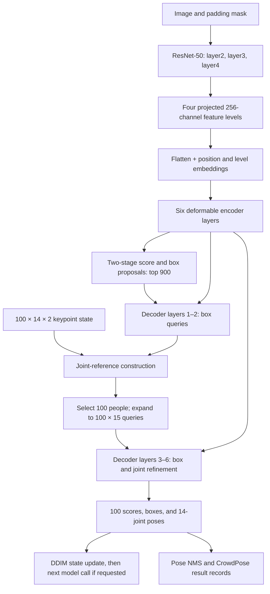

# How the native DiffusionRegPose model works

This report describes the **default, checkpoint-compatible native model** in
[`src/models/pipelines/pose_estimators/diffusionregpose/`](../src/models/pipelines/pose_estimators/diffusionregpose/),
as configured by [`conf/pipeline/diffusionregpose.yaml`](../conf/pipeline/diffusionregpose.yaml).
It explains the computation and training objective. For exhaustive parameter
counts, feature-map sizes at several resolutions, and analytical MACs, see the
[model-size report](diffusionregpose-size.md). For what the experiments achieved,
see the [chronology](diffusionregpose-to-poseflow-chronology.md).

## Model at a glance

DiffusionRegPose is an image-conditioned **set predictor**. Its encoder turns an
image into multiscale spatial memory. A two-stage proposal head chooses 900
image-derived person queries. The decoder first refines boxes, keeps 100
person candidates, then expands each into one box query and 14 joint queries.
A separate 100-proposal keypoint state influences the new joint references.
The final heads predict person scores, boxes, and keypoint coordinates. At
inference, the model feeds these predicted keypoints into a DDIM state update;
the default evaluator makes one such model call.

The diagram's 900 and 100 are different quantities: 900 is the first
two-stage proposal pool, while 100 is both the selected person-group count and
the default diffusion-state proposal count. A group has 15 tokens: one box
token plus 14 joint tokens. These counts come from the [default
configuration](../conf/pipeline/diffusionregpose.yaml) and the
[decoder expansion](../src/models/pipelines/pose_estimators/diffusionregpose/transformer.py#L412).

| Stage | Default layers or slots | Principal shape |
| --- | --- | --- |
| Input | RGB image, variable padded size | `[B, 3, H, W]` |
| Backbone | ResNet-50 layer2/3/4, strides about 8/16/32 | 512/1024/2048 channels |
| Image projections | 3 backbone levels + 1 downsampled level | 4 maps, 256 channels each |
| Encoder memory | 6 deformable layers | `[B, S, 256]`, `S = Σ H_l W_l` |
| Two-stage proposals | top 900 encoder positions | `[B, 900, 256]` plus boxes |
| Decoder layers 1–2 | box-only queries | 900 inference; 1,000 with training DN |
| Decoder layers 3–6 | 100 groups × (1 box + 14 joints) | 1,500 inference; 1,600 with DN |
| Final prediction | 100 person groups | logits `[B,100,2]`, boxes `[B,100,4]`, keypoints `[B,100,42]` |

At the common 800×1333 padded shape, the four projected maps are approximately
100×167, 50×84, 25×42, and 13×21, giving **22,223 image tokens**. Actual
shapes follow the resized image and batch padding. The default model has
**49,527,324 unique parameters**, of which 49,304,924 are trainable with the
ResNet stem and layer1 frozen; the [accounting method and subsystem
breakdown](diffusionregpose-size.md#complete-unique-parameter-partition) avoid
double-counting shared head objects.

## Image features and position

The [backbone](../src/models/pipelines/pose_estimators/diffusionregpose/backbone.py#L88)
uses ResNet-50 with frozen batch-normalization behavior and returns layer2,
layer3, and layer4 features. The default freezes the stem and layer1 weights.
Each returned map is projected to 256 channels with convolution and GroupNorm;
a stride-2 projection of the last map supplies the fourth level. The
[input preparation](../src/models/pipelines/pose_estimators/diffusionregpose/model.py#L321)
flattens and concatenates them, resizes the padding masks, and records each
level's `(height, width)`, start offset, and valid image ratio.

Each spatial token receives a 256-channel sine position encoding (128 height
and 128 width features), plus a learned level embedding. The padding mask
prevents padded image positions from contributing values. The model also
embeds the diffusion timestep: a sinusoidal time vector passes through an MLP,
then produces a scale and shift for the positional features **before the
encoder**. The current model applies this positional modulation on every
model call, including repeated DDIM calls; see
[`encode_features`](../src/models/pipelines/pose_estimators/diffusionregpose/model.py#L676).

## Three kinds of attention

**Encoder deformable self-attention.** Each of six encoder layers uses its
image tokens as both queries and value memory. A query predicts offsets and
weights around spatial reference points across four feature levels. By
default it has eight heads and four sampled points per head per level, so a
query samples **4 × 4 = 16 positions per head**, rather than densely reading
all `S` image tokens. Sampled values are weighted, combined across heads,
projected, and followed by a 256→2048→256 feed-forward network, residual
connections, and LayerNorm. The attention calculation and its CUDA/PyTorch
paths are in [`MultiScaleDeformableAttention`](../src/models/pipelines/pose_estimators/diffusionregpose/transformer.py#L95);
the encoder layer is [here](../src/models/pipelines/pose_estimators/diffusionregpose/transformer.py#L210).

**Decoder query self-attention.** Every one of the six decoder layers first
uses standard dense eight-head attention among its current queries. Before
expansion, those are person/box queries; afterward they are box and joint
queries. A mask controls which queries can communicate. During inference after
expansion, box queries can attend to all box queries, while joint queries
attend inside their own person group. During training, additional mask rules
isolate denoising queries and denoising groups from ordinary predictions.
See the [decoder layer](../src/models/pipelines/pose_estimators/diffusionregpose/transformer.py#L295)
and [mask construction](../src/models/pipelines/pose_estimators/diffusionregpose/model.py#L351).

**Decoder deformable cross-attention.** After self-attention, each query reads
the encoded multiscale **image** memory through the same sparse sampling
mechanism, centered on its current box or joint reference. A residual and
LayerNorm follow; then a 256→2048→256 feed-forward network runs. The default
DiffusionRegPose model has no PoseFlow codebook branch in this position. The
decoder layers are distinct parameter sets, while some prediction heads are
shared as detailed in the [size report](diffusionregpose-size.md#prediction-heads-and-parameter-sharing).

There is also a small coordinate-attention calculation during **query
expansion**. It combines the diffusion-state joint coordinates with
image-derived joint references before the pose layers begin. It is separate
from the decoder's image cross-attention; see
[`_refine_diffusion_keypoints`](../src/models/pipelines/pose_estimators/diffusionregpose/transformer.py#L482).

## From 900 proposals to 100 poses

The encoded image positions receive class and box predictions. The two-stage
path ranks them by their largest class logit and takes the top 900, supplying
both query features and normalized box references. The selected feature and
box-reference tensors are detached before the decoder, while the intermediate
class and box predictions remain available for encoder-proposal supervision.
See [`select_two_stage_queries`](../src/models/pipelines/pose_estimators/diffusionregpose/model.py#L691).

Decoder layers 1 and 2 refine boxes. At the end of layer 2, the model scores
the 900 normal queries, keeps the top 100, and creates 14 joint queries per
selected box. Learned joint identity embeddings, a pose-offset head, and
reference width/height embeddings initialize joint features and references.
The 100 diffusion-state poses enter the joint-reference construction at this
point. In layers 3–6, each box and joint token is updated by self-attention,
image cross-attention, a feed-forward block, and a prediction head. Box and
joint references are refined layer by layer. See the
[decoder loop](../src/models/pipelines/pose_estimators/diffusionregpose/transformer.py#L361)
and [expansion/refinement](../src/models/pipelines/pose_estimators/diffusionregpose/transformer.py#L412).

The final tensors are class logits (`2` channels, with CrowdPose person label
`1`), normalized `cx,cy,w,h` boxes, and 14 normalized `(x,y)` keypoints plus
14 visibility slots. In the current forward path, the output visibility slots
are a fixed `sigmoid(1)` value, **not a learned visibility head**. The first
two box-only outputs carry placeholder zero keypoint tensors. See the
[output assembly](../src/models/pipelines/pose_estimators/diffusionregpose/model.py#L494).

## What is diffused

Only the **keypoint XY proposal state** is diffused. It has shape
`[B,100,28]`: 100 candidate poses × 14 joints × 2 coordinates. Boxes,
classification logits, image features, and denoising queries are prediction
or conditioning paths, not variables in the diffusion state. The model maps
normalized joint coordinates from `[0,1]` to `[-1,1]`, multiplies by scale
`6`, and clips the state to `[-6,6]`. The cosine schedule stores 1,000 noise
levels. Its forward equation is

`x_t = sqrt(alpha_bar_t) x_0 + sqrt(1 - alpha_bar_t) epsilon`.

The [current target builder](../src/models/pipelines/pose_estimators/diffusionregpose/training.py#L350)
fills available proposal slots with same-image ground-truth keypoints and the
remaining slots with Gaussian draws, then calls `q_sample` at **timestep 0**.
It does not sample a uniform training timestep in this path. People cropped
out of the supervised target can still supply clipped diffusion proposals
through the separate `gt_diffusion_keypoints` input. If there are no such
source people either, all proposal slots are Gaussian. These proposal fillers
condition the decoder; they are **not extra labeled persons** in the matching
target.

At inference, [`sample_keypoints`](../src/models/pipelines/pose_estimators/diffusionregpose/model.py#L627)
starts from Gaussian state and, for each configured timestep pair, runs the
full image-conditioned model. The predicted normalized joint XY is converted
back to a clipped `x_0`; the sampler derives predicted noise from `(x_t,x_0)`
and makes a DDIM update. The assembled model sets `eta=0`, so the update adds
no fresh step noise. With the default `sampling_timesteps=1`, the schedule
has one pair, `(999,-1)`, and the update returns predicted `x_0`. More DDIM
steps mean more **whole-model calls**; they do not add decoder layers. The
schedule and update are in [`diffusion.py`](../src/models/pipelines/pose_estimators/diffusionregpose/diffusion.py#L37).

## Training: matching and losses

The [target builder](../src/models/pipelines/pose_estimators/diffusionregpose/training.py#L350)
converts canonical input keypoints to normalized `[0,1]` coordinates and
retains people with at least one labeled joint. Its loss mask treats both
CrowdPose `visible` and `labeled but occluded` joints as labeled (`visibility
> 0`). Boxes are normalized `cx,cy,w,h`; target area and the CrowdPose joint
sigmas enter OKS. Empty images have no positive person match but still
contribute classification negatives. The criterion is
[`DiffusionRegPoseCriterion`](../src/models/pipelines/pose_estimators/diffusionregpose/training.py#L754).

By default, [Hungarian matching](../src/models/pipelines/pose_estimators/diffusionregpose/training.py#L559)
assigns at most one clean query to each person. The matching cost uses focal
class cost plus box L1 and negative GIoU for box-only outputs; pose-capable
outputs use visibility-masked joint L1 and `(1−OKS)` in place of box geometry
for matching. These are **assignment costs**, not themselves gradients. The
matched outputs then receive differentiable losses:

| Clean loss | How it is calculated | Weight in default config |
| --- | --- | ---: |
| `loss_ce` | Sigmoid focal classification over matched positives and remaining query/class negatives; α=0.25, γ=2 | 2 |
| `loss_bbox` | L1 between matched normalized boxes | 5 |
| `loss_giou` | `1−GIoU` of matched boxes | 2 |
| `loss_keypoints` | L1 of matched joint XY, masked by labeled joints | 10 |
| `loss_oks` | `1−OKS`, using target area, sigmas, and labeled joints | 4 |

The matching weights are respectively **2, 5, 2, 10, 4** for class, box,
GIoU, joints, and OKS in the [default config](../conf/pipeline/diffusionregpose.yaml).
Losses are divided by a clamped matched-person count, including distributed
normalization when applicable. The source defines the exact focal reduction
and normalization in [`_loss_for_outputs`](../src/models/pipelines/pose_estimators/diffusionregpose/training.py#L821).

Deep supervision has three routes. The **final decoder output** receives all
five clean losses. Each of the preceding **five auxiliary decoder outputs**
is matched independently: the two box-only outputs receive class and box
losses, and the three pose-capable auxiliary outputs also receive joint and
OKS losses. Separately, the selected two-stage **encoder proposal output**
receives class, box L1, and GIoU losses, with default intermediate coefficient
`1`. There is no direct keypoint or diffusion-noise regression term on that
encoder output. See [criterion aggregation](../src/models/pipelines/pose_estimators/diffusionregpose/training.py#L962).

Training also prepends **100 denoising queries** built from repeated,
label-perturbed, box-perturbed ground-truth persons. They have known target
correspondence and are **not Hungarian-matched**. The final and auxiliary DN
outputs receive focal classification, box L1, and GIoU losses; there is no DN
keypoint loss here. Their default coefficients are `0.3` for classification,
`0.5 × 5` for box L1, and `0.5 × 2` for GIoU. Images with no people get
background labels and random DN boxes. DN construction is in
[`_prepare_denoising_queries`](../src/models/pipelines/pose_estimators/diffusionregpose/model.py#L448);
the losses are in [`_denoising_losses`](../src/models/pipelines/pose_estimators/diffusionregpose/training.py#L928).

The optional [Dynamic-K OTA matcher](../src/models/pipelines/pose_estimators/diffusionregpose/training.py#L613)
allows multiple clean query matches per person and normalizes by positive
assignments. It is **not the default** in `diffusionregpose.yaml`; its measured
selected-layer comparison is reported [separately](diffusionregpose-ota-comparison.md).

## Inference and evaluation boundary

The standalone [evaluator](../scripts/evaluation/evaluate_diffusionregpose.py)
resizes an image to short side 800 with max side 1333 by default, normalizes
it, runs the chosen checkpoint and DDIM step count, and sends the final
prediction through [CrowdPose post-processing](../src/models/pipelines/pose_estimators/diffusionregpose/evaluation.py#L274).
Post-processing ranks sigmoid query/class probabilities, selects candidates,
converts normalized boxes and keypoints to pixels, applies pose NMS, and writes
CrowdPose result records. Keypoint AP and bbox AP are then computed by their
respective CrowdPose evaluation paths. The Lightning `test_step` logs losses
only; the standalone evaluator is the full-test AP path, as documented in
[`docs/project.md`](../docs/project.md).

The native implementation was checked against the released external
checkpoint, but training it from EDPose initialization is a separate question.
Its architecture can represent and evaluate the released weights; that fact
does not imply a fresh training run will reproduce the paper's AP. The
[training-gap report](diffusionregpose-training-gap.md) records that empirical
distinction.
