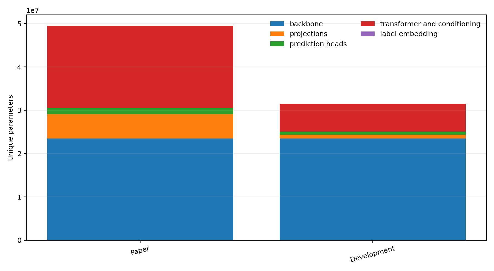
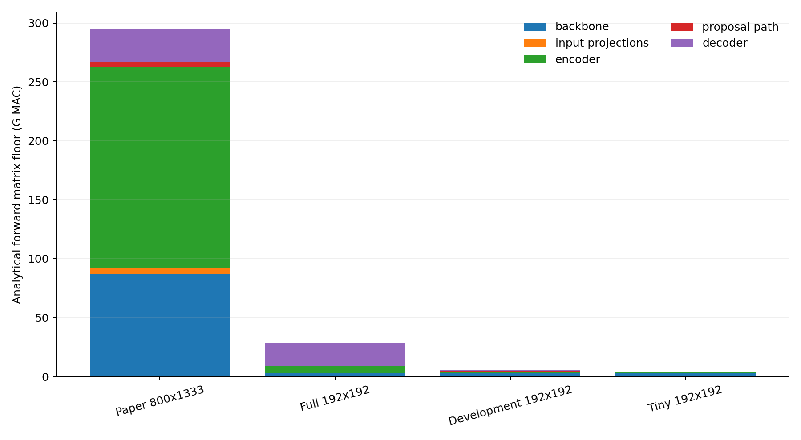
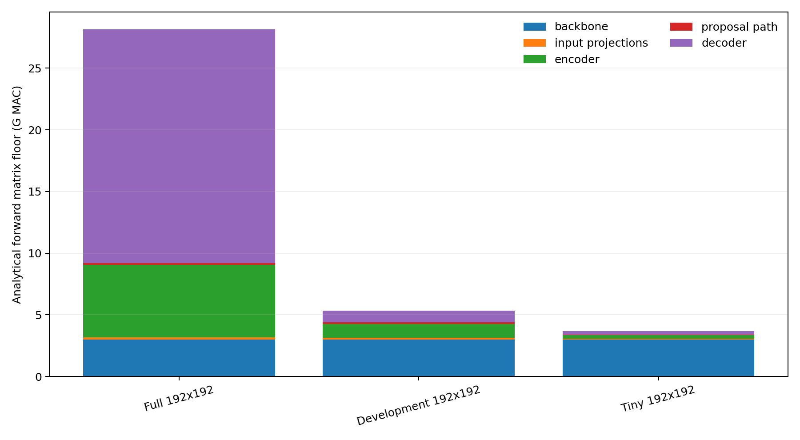
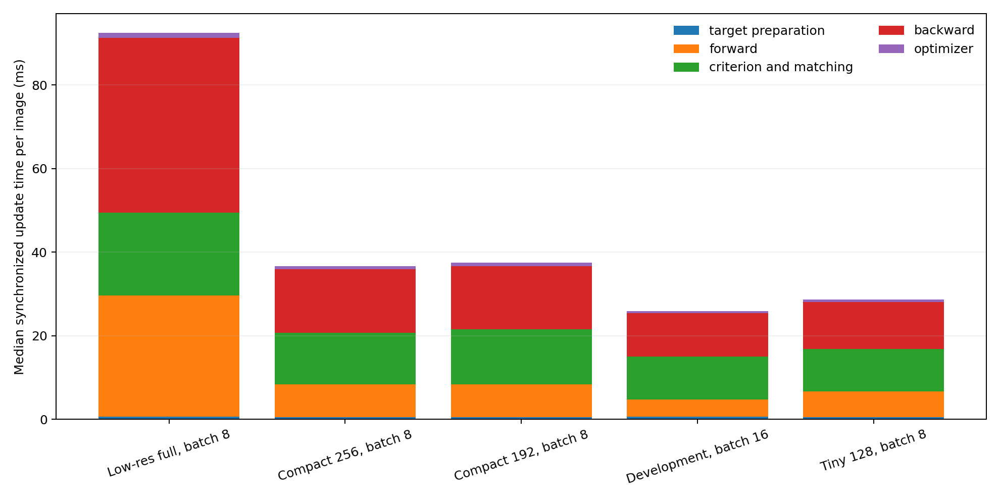
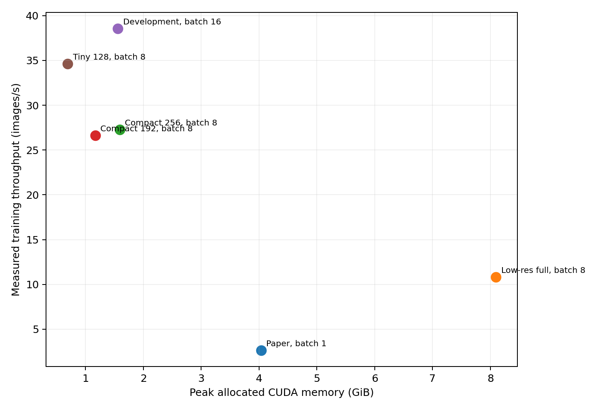

# DiffusionRegPose runtime and development-model audit

Audit date: 2026-09-09. All code paths, counts, and measurements refer to the
current native implementation under
[`src/models/pipelines/pose_estimators/diffusionregpose/`](../src/models/pipelines/pose_estimators/diffusionregpose/).

## Outcome

### Learning-gate correction (2026-09-10)

The 31.50M preset below is a successful runtime benchmark but a failed learning
proxy. Its full-data 256-pixel run reached only 0.00334 peak pose AP through
epoch 60. Aggregate checkpoint coverage hid that the backbone supplied most
loaded elements: retained EDPose coverage was only 18.15% in the encoder,
53.29% in the decoder, and zero for level embeddings. Two box decoder layers
also left only one pose-refinement layer.

The replacement preset is
`benchmark_diffusionregpose_development_compatible_256`. It retains four
feature levels, FFN width 2048, six encoder layers, six decoder layers, 200
initial queries, and 50 person/proposal/DN groups. It has 49.53M parameters and
loads 100% of retained EDPose encoder tensors, 99.97% of decoder elements, and
100% of input projections, level embeddings, and prediction heads. A new
per-component coverage gate rejects silent shape loss below 99%. Its runtime
profile measured a 681.9 ms median batch-8 update and 6.10 GiB peak allocated
memory at the 256/427-pixel data setting. This predicts about 17 minutes of
training compute per 1,500-batch epoch before validation and checkpoint I/O.
The timing tables below otherwise remain measurements of the original 31.50M
preset.

Image resolution was not the only problem. Reducing the paper model to
192-pixel inputs increased throughput, but the unchanged query layout left the
decoder, repeated Hungarian matching, and backward pass expensive. The selected
development preset therefore reduces resolution, transformer depth, FFN width,
feature levels, initial queries, output groups, and denoising queries together.

| | Paper preset | Development preset | Change |
|---|---:|---:|---:|
| Unique parameters | 49.53M | 31.50M | -36.4% |
| Encoder / decoder layers | 6 / 6 | 2 / 3 | -67% / -50% |
| Feature levels | 4 | 3 | -25% |
| Hidden / FFN width | 256 / 2048 | 256 / 1024 | 0% / -50% |
| Initial queries | 900 | 200 | -77.8% |
| Person groups / diffusion proposals | 100 / 100 | 20 / 20 | -80% |
| Denoising queries | 100 | 20 | -80% |
| Train query layout per decoder layer | 1000, 1000, then 1600 x4 | 220, 220, then 320 | substantially smaller |
| Measured throughput | 2.63 images/s at batch 1, 800x1216 | 38.58 images/s at batch 16, about 192x192 | 14.7x |
| Peak allocated CUDA memory | 4.04 GiB | 1.56 GiB | -61.4% |
| Analytical forward matrix floor | 269.35G MAC at measured paper shape | 5.34G MAC at 192x192 | -98.0% |

The throughput comparison includes both architecture and batch-size effects and
must not be read as an isolated model-only speedup. At the same low-resolution
batch size 8, reducing the full model to the 3-encoder/4-decoder, 300-query,
30-group compact model improved update time from 739.8 ms to 293.5 ms, or 2.52x.

The original measured command is:

```bash
venv/bin/python scripts/training/train_diffusionregpose.py \
    --config-name benchmark_diffusionregpose_development
```

This is now a runtime-only development model. It does not load the released DiffusionRegPose
checkpoint as a complete model and it must not be used for paper-AP claims.
Its 10% subset and batch size 16 also change the number of optimizer updates
per epoch and the effective batch size relative to paper training. The preset
is intended to answer whether architecture or training changes still learn,
not to reproduce the paper optimization trajectory.

## Measurement method

The profiler is
[`profile_diffusionregpose_runtime.py`](../scripts/investigation/profile_diffusionregpose_runtime.py).
Static counts use unique `torch.nn.Parameter` identities, so aliased decoder
heads are not counted twice. CUDA measurements used:

- NVIDIA GeForce RTX 3090, PyTorch 2.4.1+cu121, CUDA 12.1;
- FP32, the repository-owned deformable-attention forward/backward extension;
- real CrowdPose batches after the configured transforms and padding;
- three warm-up updates and ten measured updates;
- `torch.cuda.synchronize()` around top-level stages;
- CUDA events around non-overlapping forward modules;
- median, mean, p10, p90, minimum, and maximum in the raw JSON files.

The profiling process did not load EDPose weights because tensor values do not
change architecture timing materially. A separate Lightning smoke run loaded
EDPose and exercised the complete training/evaluation/checkpoint lifecycle.

The analytical counts use one MAC for one multiply-accumulate and report
`2 FLOPs = 1 MAC`. They include convolution, projection, linear, FFN, and dense
attention matrix products. They omit normalization, activation, softmax,
deformable bilinear sampling, prediction/refinement heads, matching, losses,
backward, optimizer kernels, and data movement. They are a consistent
architecture-comparison floor, not a hardware timing estimate.

Raw artifacts are under
[`reports/diffusionregpose_runtime/`](diffusionregpose_runtime/):

- [`static_profile.json`](diffusionregpose_runtime/static_profile.json)
- [`runtime_comparison.csv`](diffusionregpose_runtime/runtime_comparison.csv)
- [`parameter_comparison.csv`](diffusionregpose_runtime/parameter_comparison.csv)
- [`mac_comparison.csv`](diffusionregpose_runtime/mac_comparison.csv)
- one full JSON record for every CUDA configuration
- [`historical_timing.json`](diffusionregpose_runtime/historical_timing.json)

Regenerate the tables and plots with:

```bash
MPLBACKEND=Agg venv/bin/python -m \
    scripts.investigation.generate_diffusionregpose_runtime_report
```

## Architecture inventory

The paper model contains 16 ResNet-50 bottleneck blocks, four projected feature
levels, six deformable encoder layers, and six decoder layers. Every encoder
and decoder layer owns one multi-scale deformable-attention module; every
decoder layer also owns standard self-attention. The module inventory contains
12 deformable-attention modules, 6 multi-head self-attention modules, 127
linear modules, and 57 convolutions.

The decoder has two distinct phases:

1. Two box layers process 900 normal proposal queries, plus 100 DN queries in
   training.
2. The selected 100 groups expand into 100 x (1 box + 14 keypoints) = 1,500
   normal queries, plus 100 DN queries, for the remaining four layers.

The criterion evaluates the final output, one two-stage intermediate output,
and five auxiliary decoder outputs. That invokes Hungarian matching seven times
per image and computes DN losses for the final plus five auxiliary outputs.

The development model retains two box stages but has only one post-expansion
pose stage. Its training layout is 220 queries for the first two layers and 320
for the final layer. Final + intermediate + two auxiliary outputs invoke
Hungarian matching four times per image. CrowdPose capacity is not the immediate
limit: after excluding crowd annotations, trainval averages 4.24 people per
image and has a maximum of 14; test has a maximum of 19. Twenty groups can
represent every current image, although fewer redundant predictions may still
affect recall and optimization.

## Parameter audit



| Owned subsystem | Paper | Development |
|---|---:|---:|
| ResNet-50 backbone | 23,454,912 | 23,454,912 |
| Input projections | 5,639,168 | 919,808 |
| Prediction heads | 1,459,246 | 663,574 |
| Transformer, proposal path, time conditioning | 18,948,142 | 6,431,694 |
| Label embedding | 25,856 | 25,856 |
| **Total** | **49,527,324** | **31,495,844** |
| Trainable | 49,304,924 | 31,273,444 |

The backbone is 47.4% of the paper model but 74.5% of the selected development
model. A hypothetical ResNet-18 variant would reduce the backbone from 23.45M
to 11.17M parameters and the three projections from 0.92M to approximately
0.23M, yielding about 18.52M total parameters. It was not selected because the
measured development forward spends only 14.8 ms in the ResNet-50 plus position
path out of a 414.7 ms update, while replacing it would discard the EDPose
backbone initialization. ResNet-18 is attractive for deployment-size research,
not as the first feedback-loop optimization.

## Analytical operation audit

Let `S` be flattened feature tokens, `Q` decoder queries, `d` hidden width,
`f` FFN width, `h` heads, `L` feature levels, and `P` sampling points.

```text
encoder layer = S * [2d^2 + 3d(hLP) + 2df]

decoder layer = S*d^2
              + Q*[3d(hLP) + d^2]
              + Q*4d^2
              + 2Q^2*d
              + 2Qdf
```

The decoder's `Q^2` self-attention and per-query FFN explain why lowering image
resolution alone leaves a high fixed floor.





| Training-layout forward floor | Backbone | Projections | Encoder | Proposal | Decoder | Total |
|---|---:|---:|---:|---:|---:|---:|
| Paper, 800x1333 | 87.33G | 5.13G | 170.40G | 4.40G | 27.39G | 294.66G MAC |
| Full model, 192x192 | 3.00G | 0.17G | 5.87G | 0.15G | 18.95G | 28.15G MAC |
| Development, 192x192 | 3.00G | 0.13G | 1.10G | 0.15G | 0.95G | 5.34G MAC |
| Tiny 128-wide, 192x192 | 3.00G | 0.07G | 0.28G | 0.04G | 0.30G | 3.68G MAC |

At paper resolution the encoder is dominant. At low resolution the unchanged
full decoder becomes 67.3% of the matrix floor. In the tiny model the backbone
becomes 81.5% of analytical MACs, but measured update time does not follow that
ratio because small GPU matrices and CPU-synchronized matching dominate.

## Measured runtime and memory





| Variant | Batch / padded input | Median update | Throughput | Peak allocated | Peak reserved |
|---|---:|---:|---:|---:|---:|
| Paper architecture | 1 / 800x1216 | 380.9 ms | 2.63 img/s | 4.04 GiB | 9.72 GiB |
| Full architecture, low-res | 8 / 192x192 | 739.8 ms | 10.81 img/s | 8.10 GiB | 17.20 GiB |
| Compact 256-wide | 8 / about 192x192 | 293.5 ms | 27.26 img/s | 1.59 GiB | 2.93 GiB |
| Compact 192-wide | 8 / 192x192 | 300.4 ms | 26.63 img/s | 1.17 GiB | 2.31 GiB |
| **Selected development** | **16 / about 192x192** | **414.7 ms** | **38.58 img/s** | **1.56 GiB** | **2.71 GiB** |
| Tiny 128-wide | 8 / about 192x192 | 231.0 ms | 34.63 img/s | 0.69 GiB | 0.96 GiB |

The low-resolution full model is not cheap: batch 8 multiplies all per-image
query/matcher work and consumes twice the paper batch-1 allocated memory. The
development model fits batch 16 with less than one fifth of that allocation.

Median synchronized stages for the selected batch-16 preset are:

| Stage | Batch time | Share |
|---|---:|---:|
| Data load + transfer + augmentation | 28.0 ms | outside update |
| Target preparation | 10.3 ms | 2.5% |
| Forward | 66.7 ms | 16.1% |
| Criterion + repeated matching | 162.7 ms | 39.2% |
| Backward | 167.0 ms | 40.3% |
| Optimizer | 7.0 ms | 1.7% |
| **Update total** | **414.7 ms** | **100%** |

Within its forward pass, ResNet-50 plus position encoding takes 14.8 ms, the
encoder 5.1 ms, decoder 12.2 ms, and projections less than 0.5 ms. The remaining
roughly 34 ms covers proposal selection, denoising/mask construction, output
heads, tensor indexing/reshaping, and other model orchestration.

The matcher is now a first-class bottleneck. It loops over images and outputs,
builds costs on CUDA, transfers each small matrix to CPU, then calls SciPy's
`linear_sum_assignment`. A custom CUDA Hungarian solver is not the first
recommendation: development matrices are only about 20 by at most 14, so launch
and implementation overhead may dominate. First benchmark batched cost
construction, fewer synchronizations, parallel CPU assignment, and cached
target-independent mask sections while preserving exact assignments.

## Why the selected model

The reduction candidates rank as follows:

1. **Depth plus query/group/DN reduction:** largest verified model-only gain.
   It removes decoder self-attention, auxiliary matcher calls, and backward
   graphs together.
2. **Dataset subset:** wall time scales almost linearly and the fixed 10% split
   keeps 1,200 train, 200 validation, and 800 test images.
3. **Batch 16:** improves the selected model to 38.6 images/s. Increasing a
   related compact model from batch 8 to 32 improved throughput only 18%, so
   larger batches are not a primary optimization.
4. **Resolution:** necessary for cheap dense features, but insufficient alone.
5. **FFN/hidden width:** useful for parameters and memory. The 192/768 compact
   model was no faster than 256/2048 after other reductions, so hidden width
   256 is retained to preserve more EDPose tensors.
6. **Backbone replacement:** large parameter benefit but small expected runtime
   benefit at the selected operating point; defer until the development model
   has a measured learning baseline.

The original selected model loads 26,920,184 of 31,495,844 parameter elements (85.47%)
from the EDPose checkpoint. The incompatible entries are primarily removed
layers, fourth-level tensors, level-dependent attention offsets/weights, and
reduced FFNs. The two box-layer semantics remain aligned with the source model.
This aggregate percentage is not a valid initialization-quality gate because
the backbone dominates it; use the per-component coverage check instead.

## Feedback-loop estimate and validation status

The measured development preset has 75 training batches per epoch. Including
median loading, transfer, and augmentation, its measured batch cost predicts
about 33 seconds of training compute per epoch. Thirteen validation batches add
only a few seconds for loss, and AP sampling/post-processing measured about
56.8 ms per batch before metric accumulation. Checkpoint and logger I/O add
additional time.

An 80-epoch run is therefore expected to complete in approximately 1-1.5 hours
on this RTX 3090, rather than four to six days. This is an estimate, not a
completed 80-epoch timing.

A one-epoch integration smoke used a 1% override and the real EDPose checkpoint:

- 31,273,444 trainable parameters reported by Lightning;
- 66 missing and 298 shape-incompatible state entries, consistent with the
  intentional reductions;
- seven train batches completed, with step loss falling from 219 to 132;
- validation loss, AP evaluation, backward, optimizer, and checkpoint saving
  all completed;
- checkpoint:
  `results/diffusionregpose_development_smoke/runtime_audit_smoke/20260909_200636/checkpoints/epoch000.ckpt`.

The smoke run's AP was zero after one epoch on 20 validation images. It proves
wiring, not learning quality. The subsequent full-data run rejected this preset
as an AP feedback gate; the EDPose-compatible replacement must establish its
own initialization and epoch-10 AP before acceptance.

## Remaining optimization opportunities

- Profile criterion subcalls separately and remove avoidable CUDA/CPU
  synchronization while preserving exact matcher outputs.
- Cache target-independent normal-query attention masks by batch/device/layout;
  build only the target-dependent DN block per batch.
- Consider parallel CPU Hungarian assignment before implementing a CUDA solver.
- After establishing development AP, measure a ResNet-18 variant. Its estimated
  18.52M parameters are compelling, but its likely update-time saving is much
  smaller than its parameter saving.
- Evaluate whether 20 groups preserve AP. Although dataset cardinality fits,
  redundant predictions and matching dynamics may favor 30 or 50 groups.
- Do not change auxiliary losses merely for speed without treating that as a
  training-objective experiment.
