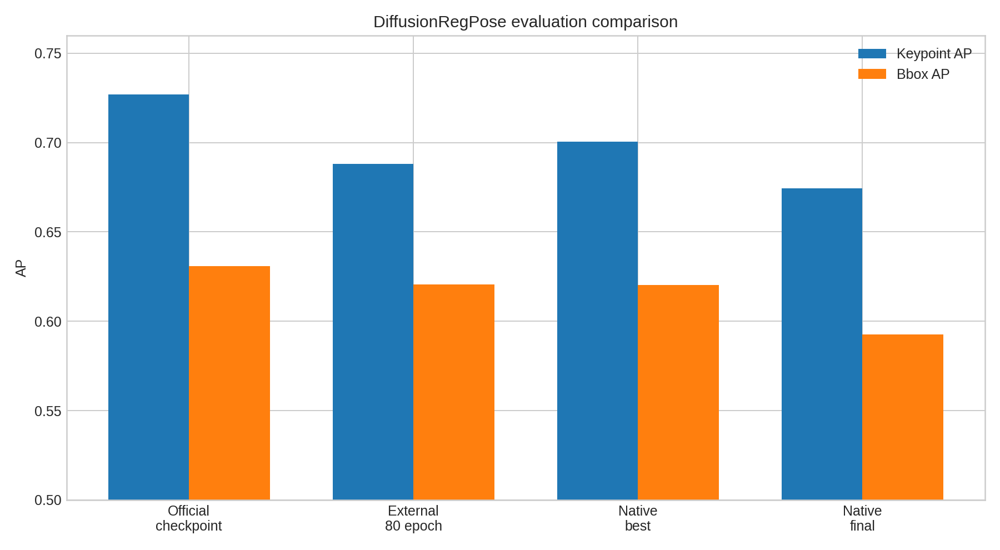
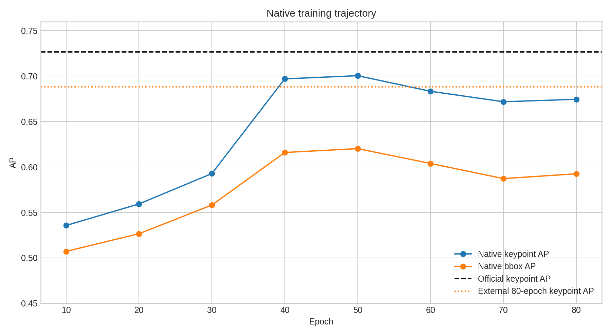
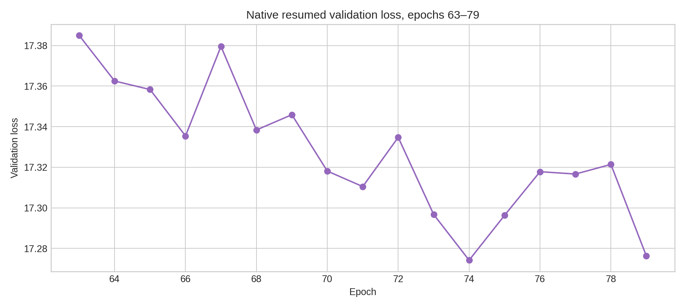

# DiffusionRegPose training gap report

Date: 2026-09-09

## Executive summary

The official released DiffusionRegPose checkpoint evaluates at **0.7268 keypoint
AP** with the repository's native evaluator. Our independent external-repository
training run reached **0.6880 AP** after its nominal 80-epoch trajectory. The
native reimplementation reached a best validation AP of **0.7005** at epoch 50,
then finished at **0.6745**.

The main conclusion is that the gap is not explained by the native evaluator or
checkpoint loading: the native evaluator reproduces the official checkpoint's
reported performance. Both our external and native training trajectories remain
below the official model, so the unresolved difference is in training provenance,
optimization trajectory, or an undocumented training detail.

## Measured comparison

| Run | Keypoint AP | Bbox AP | Evaluation | Artifact |
| --- | ---: | ---: | --- | --- |
| Official released checkpoint | 0.7268 | 0.6310 | 8,000-image CrowdPose test set | [`diffusionregpose_r50_crowdpose.pth`](../external/DiffusionRegPose/pretrain_models/diffusionregpose_r50_crowdpose.pth) |
| External reproduction, epoch 80 | 0.6880 | 0.6206 | 8,000-image CrowdPose test set | [`checkpoint.pth`](../external/DiffusionRegPose/logs/crowdpose_r50_effective_batch8_resume80/checkpoint.pth) |
| Native best, epoch 50 | 0.7005 | 0.6202 | Native validation/test split | Native run metrics history |
| Native final, epoch 80 | 0.6745 | 0.5925 | Native validation/test split | [`epoch079.ckpt`](../results/diffusionregpose_paper_full/diffusionregpose_paper_full/20260903_000016/checkpoints/epoch079.ckpt) |



The native best checkpoint is 0.0263 AP below the official checkpoint. The final
checkpoint is 0.0523 AP below it. Its bbox AP is also 0.0385 below the official
checkpoint.

## Training trajectory



The native trajectory improves strongly through roughly epoch 50, then regresses.
The final loss continues to decrease slightly while AP does not, which means
validation loss is not a reliable proxy for the CrowdPose AP objective in this
run.

The early native points in this plot were recorded before the original CSV logger
was overwritten during the first resume attempt. Epochs 69 and 79 are directly
present in the preserved resume CSV. The distinction is recorded in
[`native_trajectory.csv`](diffusionregpose_training_gap/native_trajectory.csv).

The external reproduction provides an important independent control: it used the
external training code, batch size 1, gradient accumulation 8, ED-Pose
initialization, full-resolution augmentation, and an 80-epoch target, but still
reached only 0.688 AP. This means the shortfall is not unique to the native
reimplementation.

## Native late-training loss



The resumed native validation loss remained broadly stable and slightly declined
from 17.38 to 17.28 over epochs 63–79. AP nevertheless moved from 0.6833 at the
epoch-60 evaluation to 0.6718 at epoch 70 and 0.6745 at epoch 80. This is direct
evidence that lower validation loss did not imply better AP late in training.

## What has been ruled out

### Evaluator incompatibility

The official checkpoint was evaluated natively over all 8,000 CrowdPose test
images and produced keypoint AP **0.726776**, matching the external/paper value
of approximately **0.727**. That is the strongest available evaluator anchor.

### Basic checkpoint incompatibility

The native model loads the official checkpoint and has passed deterministic
inference parity checks against the external implementation. Same-seed native
and external construction also matched all 741 shared tensors in the parity
fixture. The native model therefore has the capacity to represent the official
checkpoint.

### Native-only training failure

The external code itself produced only 0.688 AP in our full effective-batch-8
80-epoch reproduction. The native result being in the same range indicates that
the problem is broader than a single native forward implementation bug.

## What remains plausible

1. **Training provenance differs from the released checkpoint.** The official
   checkpoint may have been produced with details not captured by the visible
   configuration: exact data ordering, augmentation RNG behavior, checkpoint
   selection, or an unreleased code/config revision.

2. **The optimizer trajectory is unstable after the best point.** The native run
   peaked at epoch 50 and then regressed. The external run's final 0.688 result
   also shows that nominal epoch count alone does not reproduce the released
   result.

3. **The effective batch is not the whole story.** Both external and native runs
   used batch size 1 with accumulation 8, so the broad optimization scale was
   matched. Equal effective batches do not guarantee identical update ordering,
   augmentation samples, worker behavior, or random diffusion targets.

4. **Final-checkpoint evaluation may be suboptimal.** The native best checkpoint
   substantially outperformed the final checkpoint. This matters for reporting,
   but it cannot explain the entire gap because the best native checkpoint still
   missed 0.7268.

## Concrete configuration example

The native paper-scale run was configured with the following relevant settings:

```yaml
max_epochs: 80
batch_size: 1
accumulate_grad_batches: 8
precision: 32
lr: 0.0002
lr_backbone: 0.0001
lr_decay_milestones: [31, 61]
pretrained_checkpoint: external/DiffusionRegPose/pretrain_models/edpose_r50_crowdpose.pth
train_ann: crowdpose/annotations/crowdpose_trainval.json
val_ann: crowdpose/annotations/crowdpose_test.json
train_random_flip: true
train_random_crop: true
```

The external reproduction recorded the corresponding batch, accumulation,
80-epoch, full-resolution augmentation, and milestone settings in
[`config_args_all.json`](../external/DiffusionRegPose/logs/crowdpose_r50_effective_batch8_resume80/config_args_all.json).

## Bottom line

The evidence does not support the claim that the native implementation is simply
wrong. It can load and evaluate the official model correctly, and it achieves a
similar result to our independently trained external model. The unresolved gap
is between our training trajectories and the authors' released checkpoint.

The most useful next experiment is a controlled training-provenance comparison:
fix the exact sample order, augmentation decisions, diffusion noise/timesteps,
optimizer updates, and checkpoint selection for a short paired run, then compare
losses and parameters after every optimizer step. That can identify whether the
remaining difference is an implementation mismatch or an unrecoverable difference
in the original training recipe.

## Reproduction

Generate the plots and tabular artifacts with:

```bash
venv/bin/python scripts/investigation/generate_diffusionregpose_report.py
```

The generated files are in
[`reports/diffusionregpose_training_gap/`](diffusionregpose_training_gap/).
